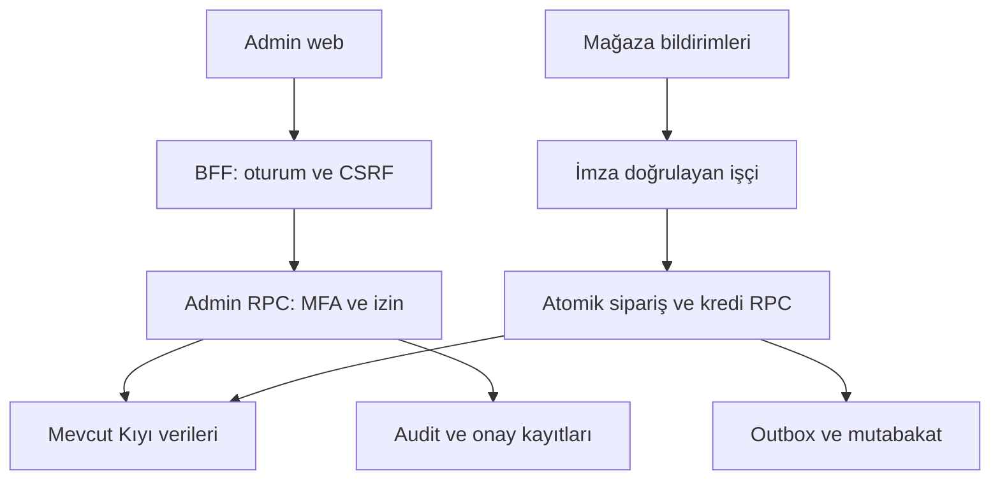

# Kıyı Admin Paneli — Araştırma, Sistem Analizi ve Uygulama Planı

23 Ekim 2026 · Araştırma sürümü 1.0 · Kodlama/dağıtım onayı içermez

## Karar özeti

Kıyı için ayrı dağıtılan, yalnızca davetli yetkililerin girdiği bir web yönetim uygulaması öneriyorum. Mevcut Supabase veritabanı ve çalışan kullanıcı uygulaması korunmalı. Yeni panel, mevcut `kiyi_command` kullanıcı API’sine yönetici bayrağı eklenerek yapılmamalı; ayrı, dar yetkili yönetim API’si kullanılmalı.

Önce plaka tekilliği, konum mahremiyeti, moderasyon, silme ve finansal denetim temelleri tamamlanmalı. Ödeme ve Premium satın alma entegrasyonu hazır olmadan satış ekranı üretimde açılmamalı. Buluşmalar pasif kalmalı; İzmir için bölge/koordinat oluşturulmamalı. Gelişmiş grafikler ve toplu pazarlama ilk sürümün ön koşulu değil.

Bu belge istenen on teslimatı kapsar: mevcut durum, özellik envanteri, öncelik, navigasyon, veri modeli, yetki matrisi, riskler, tasarım, maliyet ve testli geliştirme sırası.

## 1. İnceleme kapsamı ve kanıt düzeyi

### Doğrulanan kaynaklar

- Ekli `kiyi-antalya-proje-2026-10-23(2)(1).zip` açılıp uygulama, SQL, API, mobil kabuk, testler ve yayın hazırlığı dosyaları incelendi.
- ZIP’teki Supabase adresiyle eşleşen `oswpkwwbjwyktuqcakhr` projesinde yalnız SELECT ve sistem kataloğu okumaları yapıldı. `public.kiyi_*` tabloları, `kiyi_private` fonksiyonları, indeksler, GRANT/REVOKE, RLS politikaları, migration geçmişi ve danışman raporları incelendi. Özel kullanıcı kayıtları indirilmedi.
- Canlı projede beş migration mevcut: `kiyi_accounts_and_catalog`, `kiyi_unified_domain`, `kiyi_domain_validation`, `kiyi_profile_query_scope`, `kiyi_directory_record_scope`.
- İnceleme anında `kiyi_profiles`, `kiyi_positions`, `kiyi_orders`, `kiyi_ledger` tablolarının her birinde 0 satır vardı. Bu anlık durumdur; uygulamanın başka ortamlardaki kullanımını göstermez.
- Canlı bölgeler Konyaaltı, Lara, Kültür ve Bozkan; dördünün geometrisi PostGIS açısından geçerli. Geometrik geçerlilik saha doğruluğu değildir. Lara/Kültür/Bozkan Premium, Konyaaltı ücretsiz.
- Supabase Edge Functions listesi boş. Çalışan sunucu mantığının önemli kısmı Postgres RPC fonksiyonlarında; müzik sunucusu Cloudflare uyumlu uygulama tarafında.
- Yerelde mevcut testler çalıştırıldı: `node --test tests/*.test.cjs tests/*.test.mjs` → 73 başarılı, 0 başarısız. SQL entegrasyon dosyaları okundu fakat canlı veritabanında çalıştırılmadı: rollback içerseler bile geçici veri yazıyorlar.

### Bu çalışmanın doğrulamadıkları

Canlı web dağıtımı, gerçek e-posta teslimi/SMTP, Auth redirect ayarları, iki cihazlı gerçek giriş, mağaza hesapları, gerçek satın alma/iadeler, Spotify üretim anahtarları, iPhone/TestFlight, D1/R2 içeriği ve yedekten geri dönüş denenmedi. Gerçek GPS çok kullanıcılı test ve yük testi yapılmadı. Rapor, penetrasyon testi veya hukuki uygunluk belgesi değildir.

README birikimli ve bazı bölümleri eski. `supabase/README.md` son birleşik model hakkında daha güncel; yine de kararlar yalnız açıklamalara değil SQL, istemci ve canlı şemaya dayandırıldı. `app-store/release-status.json` bütün yayın kapılarını kapalı tutuyor; bazı eski alanlar son backend ilerlemesini yansıtmıyor. Bunları otomatik olarak “tamamlandı” saymak yanlış olur.

### Mevcut teknoloji

Kullanıcı arayüzü ağırlıkla `public/kiyi.html` ve global JavaScript dosyaları. `app/route.ts` HTML’yi sunuyor. React/Next uyumlu Vinext/Vite, Cloudflare Worker, shadcn bileşenleri, Recharts ve Tailwind altyapısı paket içinde. Mobil `mobile/` altında Capacitor iOS kabuğu var; tam yerel iOS ürünü veya doğrulanmış StoreKit akışı yok.

Eski D1/R2 durum sistemi `lib/status-api.mjs`, `db/schema.ts`, `drizzle/` altında korunuyor; `app/api/status/[[...path]]/route.ts` artık 410 dönüyor. Eski veri silinmemiş/migre edilmemiş. Gelecekte aktarım gerekiyorsa ChatGPT kimliği ile Supabase kimliği doğrulanarak eşlenmeli; benzer isim/e-posta varsayımıyla birleştirme yapılmamalı.

## 2. Mevcut sistem analizi

Durumlar: **Altyapı mevcut** = kod + şema var, üretim uçtan uca doğrulaması sınırlı; **Kısmi** = temel var ama iş akışı eksik; **Demo** = cihaz/kurgusal veri; **Yok** = uygulanmamış.

| Sistem | Gerçek mevcut durum | Kod/veri kanıtı ve eksik |
|---|---|---|
| Kayıt/giriş | Altyapı mevcut | `supabase-account.js`: e-posta/şifre, token yenileme, sekme kapsamlı sessionStorage. SMTP/doğrulama ve gerçek iki cihaz testi yok; şifre kurtarma kullanıcı akışı eksik. |
| Profiller | Altyapı mevcut | `kiyi_profiles` + `profile` RPC; alan beyaz listesi, sunucuda kimlik. Araç/model/sosyal bağlantılar JSON’da. |
| Plaka kaydı/arama | Kısmi | `directory` normalize arama ve aramaya açık profil sınırı uygular; SQL kalıbı canlı fonksiyondan alınarak salt okunur örnekte `07 DEM 001 → 07DEM001` doğrulandı. Plaka JSON alanı; UNIQUE, sahiplik veya biçim doğrulaması yok. |
| Plaka doğrulama | Kısmi | `kiyi_verifications` not/plaka/onay başvurusu saklar. Belge doğrulama, karar yetkisi, inceleme UI’si yok. Mor tik ile araç sahipliği aynı şey sayılmamalı. |
| Araç/fotoğraf | Altyapı mevcut, kısmi güvenlik | Profil JSON’u; `kiyi-media` özel bucket, kullanıcı klasörü, 5 MB/MIME sınırı. Moderasyon, EXIF temizliği, yeni akışta sunucu dosya imzası kontrolü eksik. |
| Takip/favori/engel | Altyapı mevcut | `kiyi_follows`, `favorites`, `blocks`; iki yönlü engel, takipçiyi çıkarma. Engel takip/favori ve konum onayını temizler. |
| Harita/canlı konum | Kısmi | Gerçek hesap RPC konumu yazar, son noktayı tutar; istemci 5 sn gönderim, 15 sn sorgulama, haritada 90 sn tazelik. Demo araçlar ayrı. Kesin koordinat sunumu, sunucu hız limiti ve yük testi eksik. |
| Bölgesel görünürlük | Altyapı mevcut | PostGIS bölge kontrolü; Lara/Kültür/Bozkan Premium. 200 konum sınırı var; tamamını saydığı kabul edilemez. |
| Hayalet | Kısmi | Sunucuda `privacy.ghost`; ücretsiz izleyiciye kimliksiz, Premium’a açık. Kesin koordinatlar hayalet yanıtta da var. Ayrı ücretli hayalet ürünü yok. |
| Premium | Kısmi | `entitlements.premium_until`, sunucu kontrolü mevcut; mağaza satın alma/yenileme/iptal/iade ve abonelik geçmişi yok. |
| Fenomen/mor tik | Kısmi/demo | Sunucuda `verified` var; `person()` gerçek hesaplarda `featured:false` üretir. Fenomen sıralaması ve görünürlük istisnası gerçek modelde yok; demo kodda var. |
| Kredi cüzdanı/harcama | Altyapı mevcut | `wallets`, `ledger`, kullanıcı kilidi, bakiye alt sınırı ve idempotency var. Kullanıcı doğrudan bakiye yazamaz. Gerçek satın alma ile bakiye doldurma yok. |
| Paket/satın alma | Katalog mevcut; satış yok | `credit_packs`, `orders`; ödeme doğrulama veya webhook yok. `orders` tablosunun varlığı ödeme entegrasyonu anlamına gelmez. |
| Hediye | Altyapı mevcut | `gift` komutunda bakiye, hediye, ledger ve uygulama içi bildirim aynı transaction. Gerçek bakiyeli kullanıcı testi yapılmadı. |
| Şarkı gönderme | Kısmi | 60 kredi; Spotify/Apple/iTunes bağlantı doğrulaması, katalog seçici. Canlı Spotify erişimi/anahtarları doğrulanmadı. Tam müzik oynatma yok. |
| Plaka/araç rengi | Altyapı mevcut | `appearance`, `inventory`; plaka 100, renk 500 RPC içinde sabit. Siyah/beyaz ücretsiz. Katalog fiyatını değiştirmek bu sabitleri değiştirmez. |
| Çerçeveler | Kısmi | İzin verilen çerçeve seçimi sunucuda; mevcut `appearance` dalında çerçeve bedeli uygulanmıyor. Çerçevelerin hepsi ücretliymiş gibi gelir hesabı yapılamaz. |
| Bildirim/gelen kutusu | Kısmi | Hediyeye bağlı kalıcı bildirim ve okundu mevcut. APNs/FCM yok; cihaz tablosu rezerv model. |
| Profil ziyaretleri | Altyapı mevcut | `visits`: owner/visitor son ziyaret; tam ziyaret olayı geçmişi değil. Kullanıcı kendi ziyaretçisini okur. |
| Buluşmalar | Pasif/demo | Yerel topluluk kodu/testi var; üretim buluşma veri modeli yok. Kapalı kalacak. |
| Şikâyet/moderasyon | Kısmi | Kullanıcı hedefli şikâyet kaydı ve saatte 10 sınırı var. İçerik bazlı şikâyet, dosya kanıtı, atama, karar, itiraz ve admin UI yok. |
| Durum/yorum/anket/ses | Altyapı mevcut | İstenen listede ayrıca vurgulanmamış ama `posts`, `comments`, `likes`, `votes` gerçek modelde var. 50 paylaşım, paylaşım başına 100 yorum limiti. Moderasyon kapsamına mutlaka alınmalı. |
| Hesap/veri silme | Yok | `deleteLocalKiyiData` sadece cihazdaki demo verilerini siler. Bulut hesabı, medya ve finansal saklama iş akışı yok. |
| Yönetim paneli | Yok | Yönetici üyeliği, MFA zorunluluğu, audit, finans onayı ve admin sayfaları yok. Supabase paneli uygulama admin paneli yerine geçmez. |

### Gerçek katalog: fiyat değişikliği yapılmadı

| Paket | Ana + bonus | Toplam kredi | Veritabanındaki TL |
|---|---:|---:|---:|
| small | 50 + 5 | 55 | 49,99 |
| medium | 150 + 40 | 190 | 149,99 |
| large | 400 + 200 | 600 | 399,99 |
| plus | 1.000 + 600 | 1.600 | 999,99 |
| max | 2.200 + 1.800 | 4.000 | 2.199,99 |

`app-store/products.json` ise 100/250/600 kredi ve farklı taslak fiyatlar tanımlıyor. Bu iki kaynak tutarsız. Mağaza kaydı yapılmış kabul edilemez; SKU eşlemesi ve sürümlü paket tanımı satıştan önce tekleştirilmeli. Eski konuşmalardaki paket tercihleri mevcut şemanın kanıtı yerine kullanılmadı.

Hediyeler: gül/lale/nazar 20, buket 40, dostluk 10, kahve 40, çay 50, yüzük 300, kedi 222, limon 40, çakmak 50. Şarkı 60; ürün tablosunda araç rengi 500, plaka 100. Gerçek kullanıcıda satın alma yok; demo para gerçek hesaba aktarılmıyor.

## 3. Kritik teknik bulgular ve yayın kapıları

| Öncelik | Doğrulanmış bulgu | Sonuç / gerekli tasarım |
|---|---|---|
| P0 | Plaka `profile` JSON’unda, tekil indeks yok | Aynı plaka farklı hesaplara yazılabilir. Normalize plaka kaydı ve uyuşmazlık süreci şart. |
| P0 | `map` hem açık hem hayalet yanıtta `lat/lng` döndürüyor | Kimliği gizlemek konumu anonimleştirmez. Sunucuda yaklaşıklaştırma, kısa TTL ve veri minimizasyonu. |
| P0 | `person()` çoğu profil JSON alanını çıkarma listesiyle döndürüyor | Özel alanın sonradan eklenmesi sızıntı yapabilir. Açık DTO beyaz listesi ve özel/açık profil ayrımı. |
| P0 | `can_post` engel/görünürlük kontrolü yapıyor; yazarın suspended durumunu kontrol etmiyor | Askıya alınmış hesabın içerik/medya erişimi tüm okuma yollarında kapanmalı. Sadece `person()` null dönmesi yeterli değil. |
| P0 | Ödeme doğrulama, silme ve moderasyon operasyonu yok | Satış veya mağaza yayını öncesinde bu akışlar tamamlanmalı. Satışsız pilot için ödeme kapalı tutulabilir. |
| P1 | Konum yazma sıklığı yalnız istemcide kısıtlı; yeni session ID eski sıralamayı aşabilir | Sunucu rate limit, geçerli tur oturumu, sıra ve sonlandırma doğrulaması. GPS gerçekliği garanti edilemez. |
| P1 | 90 sn eskilik sadece okuma filtresi | Beklenmeyen bağlantı kopmasında son konum fiziksel olarak kalabilir. TTL temizleyici ve alarm gerekir. |
| P1 | `appearance` fiyatları RPC’de sabit | Admin ürün fiyatı değişirse sunucu gerçek tahsilatıyla ayrışır. Tek katalog/versiyon kaynağı kullanılmalı. |
| P1 | `ledger` ve siparişler Auth kullanıcısına cascade bağlı | Hesap silme mali delili silmemeli. Kimlikten ayrılmış finansal saklama planı önce gelmeli. |
| P1 | Profil doğrulama tekrar başvuruda eski satırı ezer | Karar ve başvuru tarihçesi ayrı, değiştirilemez olay kayıtlarına alınmalı. |
| P1 | `bundle` 15 sn’de ilişkiler+son 100 ledger/hediye/bildirim taşır | Büyük kullanıcıda tekrarlı sorgu/egress; delta, sayfalama ve bölünmüş endpoint gerekir. |
| P1 | Online rozeti son 90 sn konuma bağlı | Online kullanıcı ile konum paylaşan kullanıcı aynı metrik değil; ayrı heartbeat tasarlanmalı. |
| P1 | Medya signed URL ömrü istemcide 3.600 sn | Engel/silme sonrası kopyalanmış link anında kapanmaz. Hassas medyada daha kısa erişim veya doğrulamalı proxy. |
| P1 | Gerçek fenomen istisnası yok | Demo davranışı korunup sunucuya taşınmalı; verified=fenomen varsayılmamalı. |
| P2 | README ve yayın kapısı dosyaları tarihsel çelişkili | Tek sürüm manifesti ve kanıt bağlantılı readiness checklist. |

Supabase security advisor Kıyı domain tablolarında “RLS açık, politika yok” bilgi düzeyi kaydı veriyor. Doğrudan tablo yetkileri kaldırılmış ve erişim kontrollü RPC üzerinden olduğu için bu tek başına açık erişim kanıtı değildir. Çözüm herkese `USING(true)` politikası eklemek değildir. İlgili açıklama: https://supabase.com/docs/guides/database/database-linter?lint=0008_rls_enabled_no_policy . Güvenlik danışmanı sonucunun temiz/INFO olması iş kurallarının güvenli olduğuna dair garanti değildir.

## 4. Panel mimarisi ve erişim sınırı

### Önerilen yapı

- Ayrı web uygulaması, ayrı origin ve dağıtım; örneğin alan adı edinilirse `admin.<alan-adı>`. Bu ad yalnız örnektir, yayın yapılmadı.
- İlk etapta aynı Supabase projesi: ikinci backend/kimlik havuzu maliyeti ve veri kopyası gereksiz. Mevcut proje başka uygulamanın `lab` şemasını ve ortak Auth’u da barındırıyor. Kıyı endpointleri yalnız `kiyi_*` veri kapsamını işlemeli. Dashboard’da `auth.users` toplamı Kıyı kullanıcı sayısı diye gösterilmemeli.
- Yönetici kimliği Supabase Auth; üyelik `kiyi_private.admin_memberships` tablosunda davetle. Kullanıcı kayıt formu rol atayamaz. TOTP MFA ve `aal2` tüm yönetici okumalarında ve yazmalarında aranmalı. Supabase’in kendi organizasyon MFA’sı ile uygulama admin MFA’sı ayrı kontrollerdir. [S3, S4]
- Admin web sunucusu BFF görevi görür; browser → BFF → JWT taşıyan admin RPC → özel tablolar. Normal yönetimde service-role ile kullanıcı JWT’sini bypass etme. Veritabanı fonksiyonu aynı kimlik, aktif üyelik, izin, kapsam ve MFA’yı tekrar doğrular.
- Auth kullanıcı silme gibi zorunlu işlemler ve imzalı sağlayıcı webhook’ları ayrı sunucu işçisinde; gizli anahtarlar sadece secret store’da. Service role tüm RLS’yi aşabildiğinden ayrıca Kıyı aidiyeti/nesne kapsamı denetlenmeli. İstemciden gelen `actor_id` yönetici kimliği sayılmamalı.
- Admin’e özel session, sunucuda doğrulanmış JWT ve iptal denetimi; HttpOnly/Secure/SameSite cookie, CSRF/Origin kontrolü, oturum sonlandırma, 15 dk boşta/8 saat mutlak süre önerisi. Bu süreler tasarım tercihi, mevcut özellik değil. Kritik işlemde yeniden MFA.
- DB’de uygulama yöneticisine ham SQL/DDL veya sınırsız tablo UPDATE verilmez. Admin RPC komutları açık izin isimleriyle: `users.read_basic`, `reports.decide`, `wallets.adjust`, `catalog.publish`, `roles.assign` gibi.
- Üyelik iptali her istekte DB’den okunmalı; eski JWT rolünün token süresi bitene kadar yetki vermesi önlenmeli. `user_metadata` yetki kaynağı olamaz. [S4, S5]

Önerilen bileşen ilişkisi:

Panelin ana kullanıcı uygulamasındaki global fonksiyonları yeniden tanımlamasına ihtiyaç yok. Panelde mevcut `components/ui` bileşenleri ve görsel tokenlar yeniden kullanılabilir; kullanıcı sayfasının script sırası panelden bağımsız kalır.

### İlk sürüm rol sadeleştirmesi

Tek kişiyle başlanırsa yalnız Owner/Super Admin aktif üyelik yeterli; Moderator ikinci davetli rol olabilir. Admin/Finans/Destek izin kümeleri tasarlanır ama boş hesaplar veya ortak şifreler oluşturulmaz. İki kişi yokken çift onay varmış gibi gösterilmez: yüksek riskli toplu finans/rol işlemleri kapalı, zorunlu tek sahip işlemi yeniden MFA ve açık “tek yetkili istisnası” kaydıyla sınırlı olmalı.

## 5. Özellik envanteri ve menü mimarisi

Her ekran server-side filtre/sıralama, cursor sayfalama, veri zamanı, boş/hata/yetkisiz durumları ve izin bazlı sütunlar içermeli. Detay erişimleri audit’e yazılmalı; arama sonuçları tam özel veri göstermemeli.

| Menü / önerilen route | Sayfa ve alt özellikler | Aşama |
|---|---|---|
| Özet `/` | Kritik uyarılar, bekleyen işler, temel sayılar, son güncelleme, son yönetici işlemleri | MVP |
| Kullanıcılar `/users` | Kullanıcı adı/plaka/ID arama, tarih, durum, Premium/doğrulama filtreleri | MVP |
| Kullanıcı `/users/:id` | Genel profil, araç, takip sayıları; yetkiye göre cüzdan/işlem, yaptırım, başvurular, destek zaman çizelgesi | MVP |
| Güvenlik ve moderasyon `/moderation/reports` | Şikâyet kuyruğu, önem, atanan kişi, kanıt, ilgili içerik, karar gerekçesi | MVP |
| İçerikler `/moderation/content` | Profil/araç fotoğrafı, durum, yorum, anket, ses ve sosyal bağlantı moderasyonu; gizle/geri al | MVP |
| Yaptırımlar ve itirazlar `/moderation/actions` | Uyarı, geçici askı, kalıcı kapatma; süre sonu işçisi; itirazı farklı kişi inceleme | MVP temel, A2 gelişmiş |
| Plakalar `/plates` | Normalize kayıt, mükerrer/uyuşmazlık, değişiklik geçmişi, sahiplik başvurusu | MVP |
| Doğrulama `/verification` | Plaka sahipliği ve hesap rozeti ayrı kuyruklar; özel belge erişim kaydı | MVP |
| Ekonomi `/economy` | Cüzdan/ledger arama, hediye/özelleştirme tahsilatı, mutabakat farkları | MVP salt okunur + kontrollü düzeltme |
| Siparişler `/economy/orders` | Sağlayıcı durumu, doğrulama hataları, satın alma geçmişi, iade/ters ibraz, yeniden işleme | Satış açılmadan MVP |
| Paketler/kampanyalar `/economy/packs` | Mağaza SKU, ana/bonus, ülke/kanal, sürüm, sunum/sıra; planlı yayın | MVP eşleme, A2 kampanya |
| Katalog `/catalog` | Hediyeler, şarkı gönderme ücreti, plaka/renk/çerçeve; aktif/pasif, görsel, fiyat sürümü, önizleme | MVP temel, A2 gelişmiş |
| Premium `/premium` | Entitlement, başlangıç/bitiş, sağlayıcı aboneliği, iptal/yenileme/iade, destek teşhisi | Satış açılmadan MVP |
| Görünürlük `/visibility` | Hayalet/Premium/bölge/fenomen karar matrisi; örnek kullanıcı bağlamında neden analizi | MVP salt okunur; A2 sürümlü kural |
| Harita `/regions` | Antalya bölge listesi, aktiflik, Premium koşulu, anonim sayılar, gecikme/hata | MVP |
| Bölge detayı `/regions/:id` | Sınır sürümü, saha onayı, geometri önizleme, değişiklik etki analizi | A2; MVP güvenli kapatma |
| Fenomenler `/featured` | Fenomen belirle/kaldır, sıra, süre, izin/rozete bağımsız görünürlük | MVP temel, A2 planlı sıralama |
| Duyurular `/announcements` | Bakım/güvenlik duyurusu, önizleme, hedef, zamanlama, yayın geçmişi | MVP temel |
| Bildirim işleri `/notifications/jobs` | İzinli kitle, örnek gönderim, kuyruk, hata/tekrar/iptal, sessiz saat | A2, push sağlayıcı sonrası |
| Destek `/support` | Talep/atanan kişi, kullanıcının gördüğü hata, satın alma teşhisi; güvenli cevap şablonları | MVP temel, A2 SLA |
| Gizlilik `/privacy` | Silme/veri erişim talepleri, kimlik doğrulama, saklama istisnası, silme işçisi, hukuki tutma | MVP |
| Ayarlar `/settings` | Sürüm/özellik bayrakları, bakım, yardım/yasal içerik sürümleri, istemci minimum sürümü | MVP |
| Teknik durum `/health` | İşlem hata oranı, gecikme, kuyruk, mutabakat/TTL/yedek iş durumu, servis linkleri | MVP temel, A2 trend |
| Denetim `/audit` | Kim, ne zaman, neyi, hangi gerekçeyle değiştirdi; hassas veri erişimleri | MVP |
| Yetkililer `/staff` | Davet, rol, MFA durumu, iptal, erişim gözden geçirme | MVP |
| Analitik `/analytics` | Kohort, dönüşüm, bölge yoğunluk trendi, kampanya etkisi | A3 |

Buluşmalar için ilk sürümde yönetim modülü geliştirilmez; yalnız özellik bayrağı kapalı kalır. Ham canlı kullanıcı izleme haritası ve yönetici “kullanıcı olarak giriş yap” özelliği önerilmiyor. İlk sürümde otomatik AI cezalandırma, veri ambarı, Kubernetes, özel BI lisansı veya cihaz parmak izi sistemi gereksiz.

### İş akışı kuralları

Şikâyet: yeni → sınıflandırıldı → atandı → inceleniyor → işlem/işlemsiz karar → kullanıcıya bildirim → itiraz → kapalı. Aynı anda iki moderatörün çelişen kararını `version`/satır kilidi engellemeli. Kritik güvenlik vakası öncelik ve nöbet uyarısı alır. Hedef yalnız kullanıcı değil post/comment/media/plate olabilir. Kanıt özel depoda, sınırlı saklanır; tüm ekranlarda otomatik açılmaz.

Uyarı/askı: gerekçe kodu, açıklama, başlangıç, bitiş, yetkili, vaka ve itiraz kaydı zorunlu. Askı; arama, profil, içerik, medya, hediye ve harita yollarını kapsar. Kalıcı kapatma otomatik fiziksel veri silme değildir. Erişimi kapanan kullanıcı yine itiraz ve silme talebine ulaşabilmeli; mevcut dispatcher’ın tüm komutları reddetmesi bu uçlar için ayrı güvenli kanal gerektirir.

Katalog: taslak → doğrula → önizle → onayla → belirli zamanda yayınla → gerektiğinde yeni sürümle geri al. Eski siparişler ve hediyeler tarihsel fiyat/görsel kimliğiyle kalır. Ürün pasifse yeni tahsilat reddedilir, geçmiş hediye kaybolmaz. Kullanıcının aldığı kalıcı görünüm hakkı fiyat değişince silinmez.

## 6. Dashboard veri sözlüğü ve sorgu planı

Tarih gruplaması Europe/Istanbul, DB zamanları UTC. “Bugün” sınırı yerel 00:00; haftalık/aylık aktif için son 7/30 gün ve takvim dönemi açık etiketlenmeli. Finansal raporda tahsilat, brüt satış, iade, mağaza komisyonu ve net ödeme farklıdır. Kredi harcaması TL geliri değildir.

| Gösterge | Kaynak / hesap | Güncelleme / mevcut sınır |
|---|---|---|
| Toplam Kıyı kullanıcısı/yeni kayıt | `kiyi_profiles.created_at`; gelecekte kayıt tamamlanma alanı | 5 dk cache; ortak `auth.users` toplamı kullanılmaz |
| DAU/WAU/MAU | Yeni `activity_daily(user_id,day)`; doğrulanmış anlamlı etkileşim | 15 dk; şimdi veri yok. Günlük distinct sayıları toplanarak WAU/MAU çıkarılmaz |
| Online | Yeni kısa ömürlü `presence.last_seen`, örneğin son 90 sn | 60 sn; konum paylaşan sayıdan ayrı, yaklaşık |
| Haritadaki araçlar | taze positions + sharing + hesap durumu; sunucuda count | 60 sn; 200 limitli map listesinin length’i kullanılmaz |
| Premium | `premium_until>now()` ve askıda değil | 5 dk; abonelik sağlayıcı durumu ayrı gösterilir |
| Hayalet | taze paylaşanlar içinde ghost; toplam tercih ayrı | 60 sn, düşük yoğunlukta bölgesel sayı bastırılır |
| Kredi satışı/TL gelir/iade | Doğrulanmış order/payment event; para birimine göre | 5 dk; entegrasyon yokken “Veri kaynağı bağlı değil” |
| Hediye/şarkı | `kiyi_gifts.product`, created; kredi toplamı ayrıca | 5 dk; song ayrı kategori |
| En aktif bölgeler | 5 dakikalık toplulaştırılmış aktif sayısı/araç-dakika | 5 dk; GPS paket sayısı “kullanıcı” sayılmaz |
| Şikâyetler | status/priority/assigned_at; bekleme süresi | 30–60 sn |
| Hata/servis durumu | Yeni redakte operation log + işçi health | 1 dk; hata yok ile telemetri yok ayrı |

Admin başına aynı pahalı sorguyu tekrarlama: sunucu cache’li küçük özet endpoint, artan zaman pencereleri ve `(metric, bucket, dimensions)` tekil özet tablosu. Finansal özetler sağlayıcı olaylarından idempotent üretilir; geciken olaylar son günleri yeniden hesaplatır. Aktif kullanıcı verisi ilk kez toplanmaya başlandığı tarihten önce grafik uydurulmaz.

Beş açık admin oturumu 60 sn’de bir ekran yenilerse ayda yaklaşık 216 bin HTTP isteği yapar; 60 sn cache ile hesaplama yaklaşık 43.200 kez olur. HTTP istek sayısı tek başına Supabase faturası değildir; CPU, taranan satır, veri çıkışı ve bağlantı yükü önemlidir. MVP dashboard için Realtime zorunlu değil; tab görünmüyorsa sorgulama durmalı.

## 7. Görünürlük sözleşmesi

Öncelik: aktif hesap → iki yönlü engel → açık paylaşım → zaman aşımı → açık bölge → onaylı izleyici şartı → profil erişim politikası. Premium veya fenomen olmak engeli, paylaşım tercihini veya tazelik şartını aşamaz.

| Durum | Ücretsiz izleyici | Premium izleyici |
|---|---|---|
| Konyaaltı, hayalet kapalı | İzin kapsamında profil | İzin kapsamında profil |
| Lara/Kültür/Bozkan, normal hesap | Araç/hayalet sunumu, profil/fotoğraf gizli | İzin kapsamında profil |
| Hayalet açık, normal hesap | Hayalet kartı | İzin kapsamında profil |
| Fenomen, kamuya açık görünürlüğe katılmış | Premium bölge engelinden muaf | Aynı |
| Engel/kapalı paylaşım/eskimiş konum/onay dışı | Görünmez | Görünmez |

İlk üç satır mevcut backend davranışının ana kuralını korur. Fenomen satırı istenen/demo davranıştır ve gerçek backend’e eklenmelidir. Fenomen + hayalet çakışmasında güvenli öneri: hayalet açıkken ücretsiz izleyiciye kimlik gizlensin; fenomen Premium bölge istisnası yalnız hayalet kapalıyken işlesin. Bu çakışma mevcut gerçek modelde tanımlı değil, ürün kararı olarak uygulama öncesi netleştirilmeli.

Mevcut sunucu hayalet yanıtı `** ***` ve rastgele ID üretiyor; istenen ilk iki plaka rakamı/ad+soyad baş harfi kartı sunucuda tam karşılanmıyor. Bu sınırlı kimlik ipuçları da mahremiyet etkisi değerlendirilerek açık DTO’ya eklenmeli. Gizli tam profilin tarayıcıya indirilip CSS ile kapatılması kabul edilmez. Harita profil yetkisi ile ayrı plaka aramasındaki açık profil izni farklı bağlamlar; yanlışlıkla bütün plaka aramasına Premium zorunluluğu eklenmemeli.

## 8. Veritabanı tasarımı — mevcut nesneler korunarak

Bu bölüm hedef şemadır, çalıştırılabilir migration değildir. Geliştirmede önce canlı şema farkı alınmalı; mevcut `kiyi.sql`/`kiyi-domain.sql` tekrar çalıştırılmamalı.

### Mevcut tabloların evrimi

| Mevcut nesne | Planlanan ekleme/değişiklik |
|---|---|
| `kiyi_profiles` | `status`, `updated_at`; açık DTO beyaz listesi. Plaka JSON’dan normalize ayrı kayda kontrollü geçiş; eski alan geçici uyumluluk aynası. |
| `kiyi_entitlements` | `featured`, kaynak/sürüm, gerekirse `suspended_until`; Premium bitiş mevcut alanı korunur. Yetki/abonelik geçmişi yeni olaylardan projekte edilir. |
| `kiyi_products` | `active`, `title`, `asset_id`, `version`, `updated_at`; fiyat sürümü. Appearance sabitleri katalog SKU’dan okunur. |
| `kiyi_credit_packs` | `active`, `display_order`, `version`; mağaza/ülke SKU eşlemesi ayrı tablo. Satın alma snapshot’ı bonus dahil saklanır. |
| `kiyi_orders` | tutar minor-unit, currency, base/bonus snapshot, store product, environment, verified_at, completed_at, owner bağlama, version; sağlayıcı+environment+transaction tekilliği. |
| `kiyi_wallets`, `kiyi_ledger` | Korunur; ledger aktör/kaynak/reversal bağları, immutable kayıt, mutabakat. Finansal sahibi Auth’tan ayrılmış hesap kimliğine geçiş planı. |
| `kiyi_gifts` | tarihsel ürün/fiyat snapshot, content status; iadede eski satırı silmek yerine telafi ilişkisi. |
| `kiyi_reports` | target_type/id, severity, assigned_to, due_at, updated_at, resolution, version; mevcut kullanıcı target alanı uyumluluk için korunur. |
| `kiyi_verifications` | Hesap/plaka doğrulama ayrımı; başvuru geçmişi yeni case/events modeli, önceki başvuru ezilmez. |
| `kiyi_posts/comments` | moderation_status, hidden_at, decision_id; suspend tüm okuma ve medya yollarında uygulanır. |
| `kiyi_regions` | `active`, `city_id`, policy_version; `city='antalya'` kısıtından kontrollü FK geçişi. Mevcut 4 ID korunur; İzmir seed yok. |
| `kiyi_positions` | Sunucu tur oturumu FK, observed_at, expires_at; son nokta yaklaşımı korunur, rota arşivi oluşturulmaz. |
| `kiyi_privacy` | Sürümlü consent referansı; approved UUID dizisi büyümede `location_grants(owner,viewer)` ilişkisine taşınır. |
| `kiyi_notifications/devices` | Announcements/delivery kaynağı ve kullanıcı kategori tercihleri; token gizliliği. Push tokenı admin tablolarında gösterilmez. |
| `kiyi_visits` | Son ziyaret semantiği korunur; günlük analitik için ayrı aggregate. Gereksiz tam gezinme geçmişi tutulmaz. |

### Yeni nesneler ve ilişkiler

Yeni yönetim/özel tablolar `kiyi_private` içinde, Data API’den doğrudan açılmadan tutulmalı. Aşağıdaki kısa adlar bu şemayı ifade eder; uygulama iş tablolarının `public.kiyi_*` adlandırması korunabilir.

| Nesne | Temel alanlar ve ilişki | Aşama |
|---|---|---|
| `admin_memberships` | user_id PK→Auth, role, status, invited_by, revoked_at, version | MVP |
| `role_permissions` | role+permission PK, limits; roller kurulum koduyla, UI’dan keyfi genişletme yok | MVP |
| `audit_events` | id, actor, action, entity_type/id, reason, sanitized_before/after, request_id, timestamp, outcome | MVP |
| `approval_requests` | action, canonical payload hash, proposer, approver, expiry, state, executed_request_id | MVP kritik işler |
| `plate_claims` | id, owner, normalized_plate, display_plate, status, verified_at; aktif sahiplik tekil | MVP |
| `plate_change_requests` | old/new claim, applicant, case, status, reason | MVP |
| `verification_cases/events` | claim veya user, tür, status; olayda actor/decision/reason, evidence reference | MVP |
| `moderation_actions` | case/report FK, target, sanction, starts/ends, actor, reason, supersedes | MVP |
| `appeals` | action FK, applicant, statement, status, reviewer/decision_at | MVP |
| `media_assets` | bucket/key UNIQUE, owner, hash, mime/size, scan_status, purpose, deleted_at | MVP |
| `privacy_requests` | subject, type(delete/export/access), verified_at, due_at, state, legal_hold, job_id | MVP |
| `consent_events` | subject, purpose, text_version, grant/revoke, time, minimal context | MVP |
| `cities` / `region_versions` | city id/name/active; region FK, boundary, policy, publish/review time | MVP cities; A2 editörü |
| `tour_sessions` | owner, session, started/ended, expiry, last_seq | MVP |
| `catalog_versions` / `store_products` | ürün/pack, version, effective dates; provider/environment/product_id/territory eşlemesi | Satış öncesi |
| `payment_events` / `refunds` | provider event ID UNIQUE scoped, verified payload digest, order FK, status, attempts; refund amount/reason | Satış öncesi |
| `subscriptions` / `subscription_events` | original transaction/token, owner, state, period, grace/revocation, event ID | Satış öncesi |
| `financial_accounts` / `wallet_adjustments` | Auth’tan ayrılmış pseudonymous hesap; delta/reason/approval/request, ledger FK | Satış öncesi |
| `outbox` / `job_runs` | transaction’da olay, available_at, dedupe_key, attempts, last_error; işçi yürütme durumu | MVP |
| `feature_flags` / `config_versions` | typed value, environment, version, effective_at, approved_by | MVP |
| `activity_daily` / `metric_buckets` | user+day PK; metric+bucket+dimension PK, calculated_at, version | MVP temel; A3 gelişmiş |
| `announcements` / `delivery_jobs` | content version, category, target rule, approval, state; delivery dedupe | MVP duyuru; A2 push |
| `support_cases` / `support_events` | subject, category, case status, assignee, minimal history | MVP temel |

### İndeks, bütünlük ve yetki

- Plaka aktif sahipliği için normalize değere UNIQUE partial index; sahipliği tartışmalı kayıt otomatik onaylanmaz. Normalizasyon boşlukları kaldırıp büyük harfe çevirir; format/il kodu kontrolü sahiplik kanıtı değildir. İki eşzamanlı başvuru testi zorunlu.
- Kullanıcı adı mevcut UNIQUE korunur; büyük hacimde ad araması için gerekirse lower/trigram indeks. Destek için plaka prefix taraması varsayılan açılmaz; tam normalize eşleşme ve rate limit.
- `reports(status,priority,created_at,id)`, `reports(assigned_to,status)`; `moderation_actions(target,created_at)`; `ledger(owner,created_at,id)`; `orders(owner,created_at,id)` ve durum+tarih indeksi; `audit(actor,created_at)` / `(entity_type,entity_id,created_at)`.
- Mevcut `(region,received_at)` ve GIST boundary korunur. TTL için expires_at/received_at; overlap bölgede mevcut alfabetik ilk eşleşme yerine açık priority ve çakışma doğrulaması.
- Kullanıcı silme/katılım sorguları için followers target indeksi var; comments author, likes person, votes voter, visits visitor gibi ters FK indeksleri ihtiyaç/planla eklenmeli. Her olası alanı körlemesine indekslemek GPS yazma maliyetini büyütür.
- Finans miktarı integer/bigint minor unit; currency açık. Tüm finans işlemlerinde amount≠0, tekil işlem anahtarı ve referans FK. Siparişte nullable provider_transaction üretim tekilliğine tek başına yetmez; verified geçişinde zorunlu olmalı.
- Yeni exposed tablolar RLS açık; doğrudan grant yok veya ihtiyaca göre dar SELECT. Views `security_invoker` ya da özel şema; toplam grafik view’ları özel veriyi dolaylı sızdırmamalı. [S5]
- Privileged RPC sabit boş search_path, nitelikli adlar, EXECUTE PUBLIC/anon’dan kapalı, dar fonksiyon listesi. Mevcut security-definer yaklaşımının güvenliği fonksiyon gövdesine bağlıdır. Admin yetkisi caller JWT’siyle kontrol edilir; service role çağrıda RLS’nin koruduğu varsayılmaz.
- Audit uygulama rollerine UPDATE/DELETE kapalı, action+audit aynı transaction. DB sahibi kayıtları değiştirebilir; mutlak değiştirilemezlik iddia edilmez. Günlük hash manifesti ve ayrı şifreli arşiv daha güçlü denetim sağlar.
- Migration yaklaşımı: additive alanlar → backfill doğrulama → çift okuma/uyumluluk → constraint → istemci geçişi → gözlem → eski yolun kaldırılması. Silme/rename ilk adım olmamalı.

## 9. Güvenli kredi, satın alma ve teslim mimarisi

Mevcut bakiye düşümü iyi bir başlangıç: hesap başına transaction advisory lock, `balance>=cost` koşullu UPDATE, ledger ve hediye/bildirim aynı commit. Bunun yerine tarayıcıdan balance gönderilmemeli.

### Sipariş ve mağaza olayları

1. İstemci yalnız ürün kimliği ve mağazanın işlem kanıtını gönderir. Ücret, bonus ve Premium süresi istemciden kabul edilmez.
2. Sunucu mağaza imzası/sağlayıcı API doğrulaması, bundle/package ID, ürün, environment, işlem durumu ve kullanıcı bağını kontrol eder. iOS için App Store Server API/Notifications entegrasyonu; Android gelirse Play Developer API/RTDN adaptörü.
3. Doğrulanmış olay benzersiz provider/environment/event ID ile kaydedilir. Aynı transaction farklı hesaplara kredi veremez; accountToken benzeri kullanıcı bağı zorunlu.
4. Tek Postgres transaction: sipariş satırı kilitlenir → henüz uygulanmadıysa snapshot’taki base+bonus cüzdana eklenir → ledger/order/outbox yazılır. Network çağrısı DB transaction içinde bekletilmez; doğrulama sonucu sunucu yetkili işçi tarafından uygulanır.
5. Tekrar webhook, gecikme ve sırası ters olaylar state-machine ile karşılanır; “son gelen kazanır” kullanılmaz. Zaman aşımında kullanıcı yeniden satın almaya zorlanmaz; mevcut transaction sorgulanır.
6. Günlük sağlayıcı mutabakatı: kaçırılan event/yenileme/iade bulunur. Sipariş tablosundaki başarılı durum tek başına ödeme kanıtı sayılmaz.

### Hediye/şarkı/özelleştirme

Var olan atomik hediye akışı korunur; katalog sürümü ve aktiflik sunucuda okunur. `request_id` ile payload hash saklanmalı: aynı anahtar aynı işlemde aynı cevabı verir, farklı alıcı/üründe 409 benzeri hata üretir. Şu an hediye aynı ID+sender için eski kaydı döndürüyor; payload farkını açık karşılaştırmıyor.

Bildirim dış servise gidecekse commit sonrası outbox işçisi çalışır; APNs hatası hediyeyi yeniden ücretlendirmez. Kullanıcıya teslim = veritabanında alıcının yetkili hediye kaydı; push teslimi ayrı durum. Katalog kapanması ve eşzamanlı fiyat değişimi transaction/snapshot ile tutarlı olmalı.

Şarkı bağlantıları sunucuda izinli URL/track kimliğiyle doğrulanmalı; rastgele URL, iframe veya JS kabul edilmemeli. Katalog sağlığı düzenli kontrol edilir; kırık harici linke otomatik ikinci tahsilat yapılmaz. Spotify/Apple kapak ve katalog verisinin ticari kullanımı/saklama koşulları kaynak sözleşmesiyle değerlendirilir; ücretsiz indirilebilir dosya otomatik lisans demek değildir. [S17]

### İade ve manuel düzeltme

- Geçmiş ledger satırı değiştirilmez; ters kayıt eklenir. İade edilmiş satın alınan krediler harcanmışsa mevcut `balance>=0` kontrolü yüzünden webhook’un sonsuz hata vermemesi gerekir: kullanılmamış miktar geri alınır, kalan ayrı `recovery_due` yükümlülüğüne yazılır; yeni harcama/alış politikası kullanıcı şartları ve hukuki incelemeyle belirlenir. Mevcut pozitif bakiyeye zorla negatif yazılmaz.
- İade, hediye alıcısından keyfi para tahsilatı veya gönderilmiş hediyeyi sessizce silme değildir. Sağlayıcı iadesi ile uygulama telafisi farklı kayıtlardır.
- Manuel kredi için kullanıcı, +/− tutar, gerekçe kodu, açıklama, destek/vaka ID’si ve idempotency zorunlu. “Bakiyeyi 10.000 yap” yerine +250/−100 düzeltme olayı.
- MVP için önerilen çift onay eşiği mutlak 500 kredi; bu işletme kararıdır, mevcut kural değildir. Her toplu düzeltme ve eşik üstü işlemde öneren≠onaylayan, 24 saat onay geçerliliği, payload hash ve tek çalıştırma. Limit parametresi yönetici tarafından kendi işlemi için yükseltilemez.
- Günlük mutabakat: başlangıç bakiye + ledger toplamı = bakiye. Eski/veri aktarımı bakiyesi varsa açık opening entry. Kredi birimi toplamı ile TL satış ayrı raporlanır; nakde dönüşüm/serbest kredi transferi eklenmez.

## 10. Yönetici yetki matrisi

**G** görüntüle, **İ** işlem yap, **T** talep oluştur, **O** onayla; **—** erişim yok. Her yetki yalnız kendi veri kapsamına, MFA ve audit koşuluna bağlıdır. Super Admin uygulama iş yetkisini ifade eder; DB sahibi/root yetkisi panelden verilmez.

| Ekran / işlem | Super Admin | Admin | Moderatör | Finans | Destek |
|---|---|---|---|---|---|
| Genel operasyon özeti | G | G | G güvenlik | G finans | G destek |
| Temel kullanıcı/araç bilgisi | G | G | G vaka kapsamında | G işlem kimliği | G maskeli |
| Tam e-posta/özel iletişim | G gerekçeli | G gerekçeli | — | — | G ayrı izin ve gerekçe |
| Kesin canlı konum | — | — | — | — | — |
| Bölgesel anonim istatistik | G | G | G | — | G servis durumu |
| Şikâyet/ilgili içerik inceleme | G/İ | G/İ | G/İ | — | T/G kendi vakası |
| Geçici askı/uyarı | İ | İ | İ süre limitli | — | T |
| Kalıcı hesap kapatma | O/İ | T/İ onaylı | T | — | T |
| İtiraz kararı | İ başka inceleyen | İ başka inceleyen | İ başka inceleyen | — | T |
| Plaka doğrulama | İ/O | İ | İ ayrı yetki | — | T |
| Fenomen/mor tik verme | O/İ | T | T inceleme | — | T |
| Sipariş/ledger | G | G maskeli | — | G | G kendi talebi/özet |
| Manuel kredi | T/O/İ | T | — | T/O ayrı aktör | T |
| İade başlatma/telafi | O | T | — | T/O | T |
| Paket/ürün fiyatı | O/İ | T/İ onaylı | — | T/G | — |
| Bölge kapatma | İ | İ | T acil | — | T |
| Bölge açma/geometri/görünürlük | O/İ | T | — | — | — |
| Duyuru/bakım | İ | İ | T | — | T |
| Toplu pazarlama | O | T | — | — | — |
| Silme talebi işleme | O/İ iş akışı | İ iş akışı | T | G mali saklama | T/G talep durumu |
| Veri dışa aktarma | O kapsamlı | T | — | G mali, onaylı export | — |
| Audit okuma | G tüm | G operasyon | G kendi/vaka | G finans | G kendi |
| Yönetici davet/rol/iptal | İ/O | — | — | — | — |
| Yedekten üretime geri yükleme | Panelde yok; altyapı prosedürü | — | — | — | — |

Kalıcı kapatma, rol yükseltme, büyük kredi, toplu export ve geniş kitleli kampanya ek onay ister. Acil taciz vakasında moderatör süreli koruyucu askı koyabilir; kalıcı kapatma onayını beklerken mağdur açık bırakılmaz. Aktör kendi rolünü yükseltemez; kendi hesabının cüzdanını/rozetini değiştiremez; kendi kararının itirazını sonuçlandıramaz.

Tek sahipli kurulumda ikinci kişi onayı gereken işlemler otomatik self-approve edilmez. Rutin tekil operasyon yeniden MFA+gerekçeyle yürütülebilir; toplu veya eşik üstü finans işlemi ikinci yetkili gelene kadar kapalı kalmalı.

## 11. Konum, KVKK, saklama ve mağaza politikaları

### Hukuki doğrulama gerektiren noktalar

**Hukuki inceleme gerekir:** veri sorumlusu kimliği, işleme şartları, kullanıcı sözleşmesi, yaş politikası, VERBİS kapsamı, mali saklama süreleri, yurt dışı aktarım mekanizması, plaka sahiplik kanıtı ve ticari ileti kanal kapsamı. Teknik izin almak hukuki dayanak oluşturmanın tamamı değildir.

KVKK resmî yayınları, kişiyle ilişkilendirilebilen plaka ve konumu kişisel veri kapsamında ele alır. Profil, plaka, sosyal hesap ve konum birleşimi izlenme/taciz riskini yükseltir. Plakanın sokakta görülebilmesi sınırsız sorgulanabilir profil/konum dizini oluşturma hakkı sağlamaz. [S9]

İşleme amacı ve saklama süresi veri envanterinde ayrı belirlenmeli; aydınlatma ile açık rıza birbirine karıştırılmamalı. Konum paylaşımı isteğe bağlı ve varsayılan kapalı; geri alma görünür ve kolay. Konum izni, plaka aramasına açıklık ve pazarlama izinleri ayrı tercihler olmalı. Gereksiz kimlik/ruhsat kopyası toplama yerine en az veriyle doğrulama seçilmeli.

Canlı Supabase bölgesi eu-west-1; yurt dışı aktarım değerlendirmesi gerçek ihtiyaç. Supabase, Cloudflare, e-posta, hata kaydı ve push sağlayıcılarını kapsayan veri akışı çıkarılmalı. AB’de saklanıyor olması KVKK aktarım yükümlülüğünü kendiliğinden kaldırmaz. 2024 değişiklikleri sonrasındaki yeterlilik/uygun güvence mekanizmaları ve uygun standart sözleşme türü hukukçu tarafından belirlenmeli. [S10]

KVKK başvuru işçisi son tarih ve yanıt kanıtını izlemeli; resmî açıklamada başvurular en geç 30 gün içinde sonuçlandırılır. Silme/anonimleştirme işlemi yedek, medya ve alt işleyenleri kapsayan takip kaydı üretmeli. [S11, S12]

### Önerilen saklama politikası — yasal zorunlu süre olarak okunmamalı

| Veri | Teknik başlangıç önerisi | Silme / istisna |
|---|---|---|
| Son ham GPS noktası | Sadece aktif tur, haritada 90 sn tazelik | Tur bitince anında; TTL işçisi en çok 5 dk içinde fiziksel temizlik. Rota geçmişi yok. |
| Konum onayı/tur olayları | Sürümlü izin ve başlangıç/bitiş; koordinatsız | Amaca ve uyuşmazlığa göre hukuk incelemesi |
| Yaklaşık bölgesel metrik | 5 dk ham agregasyon 30 gün; günlük 13 ay | k<5 hücre/sayı bastırma önerisi; gerçek anonimlik testi gerekir |
| Profil ziyaretleri | Son ziyaret 30 gün önerisi | Otomatik temizleme; ayrıntılı gezinme geçmişi yok |
| Yetim/yüklenmiş kullanılmayan medya | 24 saat bekleme | Referans yoksa sil; aktif yüklemeyi yanlış silme testi |
| Doğrulama belgesi | İnceleme+itiraz için gerekli en kısa süre; başlangıç önerisi karar sonrası 30 gün | Uyuşmazlık varsa sınırlı legal hold; gereksiz kimlik alanları maskeli |
| Operasyon hata kayıtları | Redakte 30 gün | Token, ham GPS, belge, şifre loglanmaz |
| Yönetici/özel veri erişim logu | Başlangıç önerisi 12 ay | Olay/hukuki tutma kapsamında uzatılabilir; erişim sınırlı |
| Ödeme/mali kayıt | Tek teknik süre önerilmiyor | Vergi/ticaret/uyuşmazlık yükümlülükleri mali müşavir+hukukçu ile belirlenir |
| Yedekler | Plan kapsamı+offsite takvim | Restore sonrası silme listesi tekrar uygulanır; yedek erişimi yalnız kurtarma |

Kimliksiz hayalet ID’si koordinat ve saatle tekrar ilişkilendirilebilir; “anonim” etiketinin tek başına garantisi yok. Admin’de kullanıcı başına ham nokta gösterilmez. Hukuki zorunlu erişim talebi olursa ayrı inceleme ve kayıt süreci; ürüne genel izleme ekranı eklenmez.

### Mobil konum

İlk iOS sürümü foreground/When In Use ile kalmalı. Mevcut `app-readiness.js` sekme gizlenince, native runtime pause alınca turu durduruyor; `Info.plist` arka plan konum modu içermiyor. Bu davranış korunmalı. Background konum gerekiyorsa ayrı ürün aşaması: temel ihtiyaç, açık açıklama, OS izin akışı, pil/TTL, TestFlight ve politika incelemesi. Google Play background konumun temel işlev ve belirgin kullanıcı faydası için gerekçelendirilmesini ister. [S8]

### Mağaza ve bildirimler

Apple UGC için uygunsuz içerik filtreleme, şikâyet, engelleme ve ulaşılabilir iletişim bilgisi ister. iOS dijital kredi/Premium için Türkiye mağaza senaryosunda temel plan StoreKit IAP olmalı; bölgesel istisnalar ayrıca doğrulanmadan harici ödeme yönlendirmesi açılmamalı. Satın alınan krediye son kullanma tarihi koyulmamalı; hesap oluşturulan uygulamada hesap silme uygulama içinden sunulmalı. Abonelik yönetme/geri yükleme ve açık ücret/dönem bilgisi gerekir. [S6]

Google Play’e çıkılırsa dijital ürünlerde Play Billing temel kural; UGC için etkin moderasyon/şikâyet/engelleme ve hesap silme için hem uygulama içi yol hem web kaynağı gerekir. [S7, S13, S14]

Admin’den hediye kredi maliyeti, sunum sırası, duyuru ve erişim bayrağı değişebilir. Mağazada tahsil edilen TL fiyat, ürün tipi, subscription grubu/dönemi ve onaylı ürün bilgisi yerel DB alanı değiştirilerek güncellenmez. Mağaza konsolu/API süreci ve ürün geçerliliği gerekir; mobil fiyat StoreKit/Play’in yerelleştirilmiş cevabından gösterilir. Bonus değişiklikleri sürümlü paket vaadiyle uygulanmalı, mevcut satın alma hakları geriye dönük azaltılmamalı.

İşlemsel/güvenlik mesajı ile kampanya ayrı kategoriler. OS push izni pazarlama izniyle eşit sayılmaz. SMS/e-posta ticari ileti için onay/ret ve İYS yükümlülükleri değerlendirilir; push ve uygulama içi duyurunun kanal kapsamını hukukçu netleştirmeli. Uşak Ticaret İl Müdürlüğü resmî açıklaması ticari ileti onayı, ret ve İYS süreçlerini özetler. [S15]

Yeni güvenlik operasyonu: veri ihlali olayı için tespit saati, etkilenen veri, yayılımı durdurma, delil koruma, bildirim kararı ve sorumlu kişi kaydı. KVKK Kurulunun resmî açıklaması, ihlali öğrenmeden itibaren gecikmeksizin/en geç 72 saatte Kurula bildirim yükümlülüğünü açıklar; uygulama hukuk sorumlusu bu akışı işletmeli. [S16]

## 12. Tasarım araştırması ve Kıyı’ya uyarlama

Mastodon resmî yönetim dokümanı, uyarı/kısıtlama/askı ve itirazı ayrı durumlar olarak ele alıyor. Kıyı’ya aktarılacak yararlı model: geri alınabilir geçici güvenlik müdahalesi, kalıcı kararın ayrılması, kullanıcıya gerekçe ve itiraz yolu. Federasyon/domain engelleme gibi Kıyı’da ihtiyaç olmayan parçalar alınmıyor. [S18]

IBM Carbon veri tablosu modeli arama/filtre araç çubuğu, sıralama, satır genişletme, seçim ve sayfalama için iyi referans. Kıyı’da kullanıcı ve vaka listeleri buna göre; ödeme düzeltmesi ve hesap kapatma gibi ağır işlemler toplu checkbox eylemi olarak ilk sürüme konulmamalı. [S19]

Görsel öneri tasarımdır; çalışan admin ekranı yapılmadı:

- 1.440 px masaüstü: 248 px sol menü, 64 px üst bar, 24 px içerik boşluğu, 12 kolon. Üstte global arama, kritik bildirim, ortam etiketi, yetkili profili.
- Mor ana renk `#7C3AED`, açık zemin `#F7F7FB`, metin `#20212B`; karanlık zemin `#11131A`, kart `#1C1F2A`. Açık/koyu temada kontrast ayrıca doğrulanır. Mor tik yalnız doğrulamayı ifade eder; sistem sağlığı mor ile gösterilmez.
- Dashboard’da 6–8 ana kart: bekleyen kritik işler ilk sırada. İkinci sırada kayıt/aktiflik ve işlem trendi; sağda acil vakalar. Büyük kullanıcı haritası yerine anonim bölge tablosu.
- Tablo satırı yaklaşık 52 px; sticky başlık ve ilk kimlik sütunu, 25/50/100 satır seçenekleri; server cursor. CSV export izinli ve süreli, formül enjeksiyonuna karşı metin kaçışlı.
- Kullanıcı detayında başlık + Genel / Güvenlik / İşlemler / Başvurular / Yönetim geçmişi sekmeleri. Yetkisiz sekme ve API alanı ikisi de kapalı.
- Finans onayında kullanıcı, eski/yeni bakiye, delta, gerekçe, onaylayan ve etki özeti görünür. “Kaydet” yerine “250 kredi düzeltmesi uygula”. Ağ hatasında aynı request ID ile durum sorgulanır.
- Tablet: daraltılmış sidebar ve yatay kaydırmalı tablolar. Mobil: kritik vaka görüntüle/ata, geçici askı, destek ve duyuru; toplu finans, kapsamlı export, geometri düzenleme masaüstünde.
- Klavye gezinmesi, odak yönetimi, screen-reader etiketleri, renk dışında durum metni/ikon, Türkçe hata mesajları. Para `₺1.499,99`; tarih ve veri tazeliği açık. “Bağlı değil” metrikleri 0 gibi gösterilmez.

## 13. Teknik izleme, yedek ve risk kontrolü

| Kıyı paneline alınacak | Supabase/altyapı panelinde kalacak |
|---|---|
| Kullanıcı etkili RPC hata/gecikme, kredi/teslim tutarsızlığı | SQL Editor, şema yönetimi, ham Postgres logları |
| Eski konum sayısı, reddedilen güncelleme, bölge servis durumu | Compute artırma, Postgres ayarı, extensions |
| Ödeme doğrulama/abonelik/mutabakat hataları | Secret/DB şifresi değişimi, Auth sağlayıcı ayarı |
| İşçi/outbox/TTL/silme kuyruğu, son başarılı yedek kontrol zamanı | Üretime restore, proje transferi, ağ yapılandırması |
| Storage kapasitesi/egress özet ve maliyet eşik uyarısı | Fatura, plan, detay kullanım sayaçları |
| Audit ve rol/MFA olayları | Organizasyon üyeliği ve altyapı audit’i |

Admin’e Supabase Management API tokenı gönderilmez. Servis sağlık bilgisi sunucuda cache’li ve sınırlı toplanır; paneldeki günlük maliyet tahmini faturanın yerine geçmez. Maliyet/billing yetkisi olmayan yönetici fatura linkine yönlendirilse bile altyapı erişimi kazanmaz.

| Risk | Kontrol / kabul kanıtı |
|---|---|
| Yetkisiz admin/IDOR | Davetli üyelik+MFA+izin; başka role ait route ve doğrudan RPC 403/42501 |
| Hesap ele geçirme/XSS | Güvenli oturum, CSP, HTML kaçışı, URL allowlist, yeniden MFA; mevcut inline handler mimarisi nedeniyle kullanıcı app CSP’si ayrı planlanmalı |
| Plaka tarama/taklit | Normalize tekillik, opt-in, tam eşleşme, istek limiti, uyuşmazlık ve itiraz |
| Kredi manipülasyonu/çift harcama | Atomic koşullu debit, ledger, payload bağlı idempotency; eşzamanlı test |
| Sahte/tekrar satın alma | Mağaza doğrulaması+transaction kullanıcı bağı+tekillik; sandbox/production ayrımı |
| Konum takibi | Kesin koordinat DTO’dan çıkarılır, TTL, bağlama göre görünürlük, düşük sayılarda agregasyon bastırma |
| Yetkili suistimali | Gerekçeli erişim/audit, görev ayrımı, export kısıtı, düzenli rol gözden geçirme |
| Askı sonrası içerik sızıntısı | can_post/media/directory/gift/map ortak politika test matrisi |
| Dosya/kötü amaçlı içerik | Magic-byte kontrol, görüntü yeniden kodlama/EXIF temizleme, karantina, MIME/limit, key ownership |
| Servis kesintisi | Retry/backoff, circuit breaker, outbox dedupe, salt okunur/bakım modu |
| Veri kaybı | DB+Storage ayrı yedek; staging restore tatbikatı; finansal sağlayıcıyla mutabakat |
| Sahte GPS | Zaman/doğruluk/oturum/hız anomalisi, sunucu limiti; yalnız GPS’e dayanarak otomatik kalıcı ceza yok |

### Yedek/geri yükleme

Free’da düzenli şifreli offsite DB export ve Storage dosyaları için ayrı kopya gerekir. Supabase Pro günlük DB yedeği/7 günlük erişim sağlar; DB yedeği Storage dosya gövdelerini içermez. Bu ayrım özellikle kullanıcı fotoğrafları için kritiktir. [S20]

Başlangıç hedefi RPO 24 saat/RTO 4 saat bir plan hedefidir, mevcut garanti değil. Gerçek para açılınca yalnız 24 saatlik kredi defteri kaybı kabul edilmemeli: doğrulanmış ödeme olaylarının güvenli tekrar oynatılması, daha sık finansal checkpoint ve gerekiyorsa PITR. PITR hemen satın alınacak zorunlu ilk servis değil; veri kaybı toleransına göre karar verilir.

Restore önce izole ortamda yapılır: şema+RPC/grant, DB kayıtları, Storage objeleri, Auth eşlemeleri ve secrets yapılandırması ayrı doğrulanır. Silme talepleri restore edilen eski veriye tekrar uygulanır. Üretim restore panelde tek tuş olmamalı; rollback/iletişim planı ve iki yetkili prosedürü gerekir. Ortak `lab` şemasını etkileyen proje restore tüm uygulamaları etkiler; uzun vadede Kıyı’yı ayrı projeye ayırmanın ana gerekçesi budur. Bu araştırmada taşıma yapılmadı.

## 14. Maliyet ve ölçek senaryoları

23 Ekim 2026’da erişilen resmî fiyatlara göre: Free 500 MB DB, 1 GB Storage, 50.000 MAU, 5 GB egress; Pro $25/ay başlangıç, 8 GB DB, 100 GB Storage, 100.000 MAU ve 250 GB egress kapsamı. Pro’da MAU aşımı $0,00325/MAU; DB $0,125/GB, Storage $0,0213/GB, uncached egress $0,09/GB. Cached egress ayrı sayaçtır; tahminde ikisini birleştirip iki defa ücretlendirme yapılmamalı. [S1]

Realtime Free 2 milyon mesaj/200 tepe bağlantı, Pro 5 milyon/500; Pro aşımı $2,50/milyon mesaj ve $10/1.000 tepe bağlantı. Konum yayınının alıcı çoğaltması maliyeti belirler. [S2]

### Ortak varsayımlar: tahmin, ölçüm değil

Kayıtlı kullanıcının %20’si DAU, %40’ı MAU; DAU’nun %10’u günde 20 dk haritada konum paylaşır. GPS 5 sn, bundle 15 sn; örnek olarak harita kullanımında iki 15 sn RPC sayıldı. Bir aktif kullanıcı günde 5 analitik olay üretirse ham olay 200 byte/satır varsayımı; indeks/WAL/yedek hariç. Medya, oturum süresi ve bir kullanıcıya görünür araç sayısı değişirse sonuç katlanır.

| Kayıtlı | DAU / MAU | Günlük konum yazımı | Harita için aylık 15 sn RPC | Günlük 5 olayın aylık ham boyutu | Ana darboğaz |
|---|---:|---:|---:|---:|---|
| 1.000 | 200 / 400 | 4.800 | 96.000 | 6 MB | Auth teslimi, medya ve temel güvenlik |
| 10.000 | 2.000 / 4.000 | 48.000 | 960.000 | 60 MB | Büyük bundle, fotoğraf egress, indeksler |
| 50.000 | 10.000 / 20.000 | 240.000 | 4,8 milyon | 300 MB | Konum WAL/vacuum, payload ve cache |
| 250.000 | 50.000 / 100.000 | 1,2 milyon | 24 milyon | 1,5 GB | Bölgesel dağıtım, fan-out, I/O, maliyet gözlemi |

İki RPC/15 sn hesabı yalnız örnek harita oturumlarını kapsar; mevcut kod görünür tüm sayfalarda bundle poll yaptığı için gerçek toplam daha yüksek olabilir. API istekleri “sınırsız” olsa da compute/egress sınırsız değildir. DB’de son konum tek satır olsa bile yazma/WAL/bloat yükü sıfır olmaz.

Örnek tepe: aynı anda 1.000 konum gönderen × 0,2 güncelleme/sn = 200 yazma/sn; her güncelleme ortalama 20 kişiye giderse 4.000 teslim/sn. Bu seviye günde yalnız 2 saat gerçekleşse ayda 864 milyon teslim eder. Pro kapsamı düşüldüğünde yaklaşık $2.147,50 mesaj aşımı çıkar; bağlantı ve egress ayrıca. Bu, mevcut polling’in faturası değildir: kontrolsüz Realtime’a geçilirse oluşabilecek örnek risktir. Bölge kanalı bile çok kalabalık bölgede tek başına yetmez; görünür alan, izinli DTO, paketleme, frekans düşürme ve server fan-out bütçesi gerekir.

### Başlangıç bütçe zarfları — teklif/fatura değil

| Ölçek | Supabase aylık planlama aralığı | Hangi koşulla |
|---|---:|---|
| 1.000 | $0 pilot; para alan üretimde yaklaşık $25–50 | Düşük medya, sınırlı eşzamanlı kullanım, tek Kıyı projesi |
| 10.000 | $25–100 | Cache/delta, thumbnail, server-side pagination uygulanmış |
| 50.000 | $75–300 | Ölçüme göre compute, günlük agregasyon, GPS adaptif sıklık |
| 250.000 | $150–1.000+ | Kontrol edilmiş egress ve fan-out; yoğun haritada binlerce dolar da olabilir |

Bu zarflar MAU/compute/medya ayrıntısı verilmediğinde yalnız bütçe tamponudur; kullanıcı sayısından çıkarılmış kesin maliyet değildir. Örneğin 250.000 kayıtlı ama 100.000 MAU varsayımında MAU aşımı yok; hepsi aylık aktif olursa yalnız MAU ek ücreti 150.000×0,00325 = $487,50 olur. 1 TB uncached egress için 1.000 GB varsayımında yalnız aşım yaklaşık (1.000−250)×0,09=$67,50. 1 TB Storage da DB/egress’ten ayrı; 900×0,0213≈$19,17 aşım. Ölçü birimi sağlayıcı faturasındaki GB hesabıyla eşleştirilmelidir.

Aynı Pro organizasyonunda ilk Micro compute krediyle dengelenebilir; Medium liste $60 ise örnek temel $25+$60−$10=$75. Mevcut ortak projede kredinin başka proje tarafından kullanılması, ek staging compute ve kullanım faturayı değiştirir. PITR ayrıca yaklaşık $100/aydan başlıyor; MVP’ye otomatik eklenmedi. [S1]

Alan adı, SMTP, Cloudflare hosting kullanımı, mağaza üyeliği/komisyonu, vergi, kur ve hukuki danışmanlık bu Supabase zarflarında yok. Mevcut sağlayıcı limitleri görülmeden bunlara 0 TL garantisi verilmez. Ücretsiz başlangıç: mevcut hosting, TOTP, PostgreSQL aggregate/job, açık kaynak bileşenler. SMS OTP, ücretli BI, ayrı veri ambarı ilk sürüm için şart değil.

### Büyüme kuralları

- 1.000: gerçek RLS/RPC güvenliği, limitli resim boyutu, temel yedek ve operasyon; güvenlik ölçek yüzünden ertelenmez.
- 10.000: bundle’ı böl, cursor, ETag/delta, thumbnail, arama indeksi, görünmez sayfada polling kapat.
- 50.000: sıcak konum tablosu vacuum/WAL takibi, bölge bazlı cache, 5–15 sn adaptif GPS, raporların özet tablodan okunması, eşzamanlı yük testi.
- 250.000: permission-safe bölgesel yayın, yoğun bölgede küme/viewport, olay tablosu retention/partition, işçi kuyruğu ölçekleme; yalnız ölçüm gerektirirse read replica/ayrı analitik depo.
- %50/%75/%90 kota uyarıları, günlük kullanım özeti ve spend cap izleme; cap bütün maliyet kalemleri için mutlak fatura tavanı sayılmaz. En büyük risk panelin birkaç yöneticisi değil, kullanıcı haritası ve fotoğraf trafiği.

## 15. Öncelik ve küçük geliştirme aşamaları

Aşağıdaki dosyalar **önerilen** hedeflerdir; mevcut olmayanlar henüz oluşturulmadı. Admin ayrı uygulama olarak aynı repo altında `admin/` çalışma alanında başlayabilir; dağıtımı ve env’si ayrıdır. Migration adları kavramsal; geliştirmede CLI ile oluşturulmalı. Mevcut SQL snapshot’ları tekrar çalıştırılmaz.

### MVP: yayın öncesi gerekli

| İş paketi / bağımlılık | Değişecek dosya, DB nesnesi, servis | Test ve kabul kriteri |
|---|---|---|
| M0 — Kanıt ve staging; ilk | `supabase/README.md`, `app-store/READINESS.md`, `release-status.json`; yeni `docs/current-state.md`; izole yerel/staging DB | Canlı şemayla fark raporu; eski 73 test korunur; SQL testleri yalnız staging’de; üretim yazımı yok |
| M1 — Admin Auth/RBAC/audit; M0 | Yeni `admin/src/auth/*`, `admin/src/server/*`, login/MFA/layout; admin_memberships/role_permissions/audit/approval; ayrı hosting secrets | Normal kullanıcı, AAL1 ve iptal edilmiş yetkili bütün admin API’lerinde reddedilir; gizli anahtar bundle’da yok; DB değişikliği audit olmadan commit etmez |
| M2 — Kullanıcı/plaka; M1 | `public/supabase-account.js`, `supabase` yeni migration; profile DTO, plate_claims/change/verification events; admin users/plates | İki eşzamanlı aynı normalize plaka yalnız bir aktif sahiplik; opt-out ve block korunur; eski profil okunur; doğrulama otomatik tik vermez |
| M3 — Mahremiyet/konum; M1–2 | `public/cloud-domain.js`, `map-v2.js`, SQL map/position/can_post/media_allowed; tour_sessions/TTL; admin regions | Yanıt JSON’unda kesin başkasının GPS’i yok; stale/engel/onay dışı görünmez; tur bitince silinir; ağ kopuşunda TTL≤5 dk; sunucu hız limiti; Premium matrisi geçer |
| M4 — Moderasyon/silme; M1–3 | `public/status-system.js`, `app-readiness.js`, privacy/terms; reports/actions/appeals/media_assets/privacy_requests; admin moderation/privacy; worker | Askı tüm arama/içerik/medya/harita yollarında etkili; itiraz erişilebilir; silme DB+Storage+cache etkili; mali delil korunur; ortak lab/Auth hesabı yanlışlıkla silinmez |
| M5 — Finans temeli; M1,M2,M4 | Yeni ekonomi RPC/worker, orders/ledger/financial_accounts/events/adjustments/outbox; `admin/src/pages/economy/*` | Bakiye=ledger; 100 paralel harcama negatif yapmaz; hata enjeksiyonunda hediye/debit/bildirim birlikte rollback; payload uyuşmazlığı idempotency reddi; onaylayan≠öneren |
| M6 — Gerçek satış/Premium; M5 | `mobile/src/native-runtime.js` ve StoreKit köprüsü/yeni native dosyalar; `app-store/products.json`, `public/membership.js`; store mappings/subscriptions/refunds; ödeme Edge Function/worker | Sandbox gerçek satın alma, restore, pending/cancel, sahte/replay, başka hesaba claim, sırası ters yenileme, iade-harcanmış kredi testleri; mağaza fiyatı gösterilir. Geçmeden satış bayrağı kapalı |
| M7 — Katalog/rozet/görünürlük; M2,M3,M5 | `public/featured-profiles.js`, `membership.js`, RPC appearance/gift/person; catalog/config/entitlement history; admin catalog/featured | Fiyat tek sunucu kaynağı; görünüm sahipliği korunur; verified ve featured ayrı; her rol sınırı; fenomen/hayalet birleşimi onaylanmış sözleşmeyle testli |
| M8 — Operasyon ve yayın; M1–7 | Admin dashboard/health/settings/support; activity_daily/metric_buckets/jobs; mevcut mobil readiness | Grafik kaynakları/tazeliği doğru; gelir kaynağı yoksa sıfır uydurmaz; SMTP/şifre kurtarma/cihaz testleri; restore tatbikatı; Türkçe sözleşme ve destek bilgileri; mağaza checklist kanıtlı |

M6, para almayan kontrollü pilot için kapalı kalabilir. Ancak gerçek para/Premium satışı hedefli mağaza sürümünün zorunlu kapısıdır. M7’nin gelişmiş kampanya/editör kısımları MVP’ye taşınmaz; temel mevcut davranışın güvenli yönetimi yeterlidir.

### İkinci aşama: günlük işlerin hızlanması

| İş paketi | Dosya / nesne / servis | Kabul |
|---|---|---|
| A2.1 Filtre/atama/SLA ve destek | Admin users/reports/support; saved_views, support_events, job deadlines | Atama çakışması yok; süre aşımları izlenir; özel veri sütunu role göre kapalı |
| A2.2 Bildirim ve duyuru işleri | Admin notifications; devices/preferences/delivery/outbox; APNs, sonra FCM | Pazarlama reddine saygı; tek event tek bildirim; provider hata/retry iptal edilebilir |
| A2.3 Kampanya ve bölge editörü | Admin catalog/regions; catalog_versions/region_versions/cities | Zamanlı yayın/geri alma; geçersiz geometri reddi; Antalya ID’leri korunur; İzmir koordinatı eklenmez |
| A2.4 Operasyon raporu/export | Admin economy/audit; export_jobs, süreli özel Storage | Yetkili kapsam, CSV formül güvenliği, indirme TTL ve audit; ham konum export’u yok |

### Üçüncü aşama: büyüme ve gelişmiş analitik

| İş paketi | Dosya / nesne / servis | Kabul |
|---|---|---|
| A3.1 Kohort/dönüşüm | Analytics worker+admin; özet/retention tabloları | Aktiflik tanımı sabit; WAU/MAU distinct doğru; geriye dönük ölçüm sınırı görünür |
| A3.2 Harita transport optimizasyonu | cloud-domain/map adapter; izinli snapshot/broadcast servisi | Yük testinde veri sızıntısı yok; önceden seçilmiş yoğunlukta p95 hedefi ve mesaj bütçesi karşılanır |
| A3.3 Anomali/dolandırıcılık sinyalleri | worker/risk UI; risk_events, manual review | Açıklanabilir sinyal, yanlış pozitif takibi; otomatik kalıcı ceza yok |
| A3.4 Altyapı ayrışması | Deployment/env/kimlik aktarım planı; gerekirse ayrı Kıyı projesi | Lab etkilenmez, kimlik eşleme ve ledger mutabakatı tam; kontrollü rollback |

### Ortak test kapısı

- Yetki matrisi için her izin: anonymous, normal kullanıcı, AAL1, AAL2 yetkili, yetkisi alınmış kullanıcı ve farklı rol. ID değiştirme ile yetki aşılamaz.
- Finans: paralel debit, aynı ve farklı payload tekrarları, timeout sonrası retry, katalog değişimi, teslim hatası, webhook tekrar/sıra/ortam, mali mutabakat.
- Gizlilik: block iki yönlü; approved/Premium/fenomen/hayalet kombinasyonları; arama ve harita ayrımı; askı ve medya URL erişim penceresi.
- İşletme: job tekrar çalıştırılabilir; silme/TTL/outbox aksamaları alarm üretir; restore edilmiş veride eski silme talepleri yeniden uygulanır.
- Hedef performans başlangıç kriteri olarak admin liste/komut p95<1 sn, küçük özet p95<500 ms; kararlaştırılmış sentetik veri ve eşzamanlılıkta ölçülmeli. Bunlar mevcut ölçüm değil, geliştirmede doğrulanacak hedefler. Fonksiyonel test geçmesi 250.000 kullanıcı kapasitesi kanıtı sayılmaz.

## 16. Uygulamadan önce netleştirilecek ürün kararları

Bunlar araştırmayı durdurmadı; geliştirme sözleşmesine yazılmalı:

1. Fenomen hayalet açtığında ücretsiz izleyiciye gizli kalması; güvenli öneri budur.
2. Hayaletin Premium’a dahil mi yoksa ayrı ürün mü olacağı: mevcut backend’de ayrı ürün yok; yeni ücret varsayılmadı.
3. Plaka doğrulamada asgari kanıt ve plaka devrinde gerçek sahibin itiraz süreci; tam ruhsat/kamu veri sorgusu varsayılmadı.
4. Mağaza SKU/bonus/fiyatlarının son sürümü: canlı DB ile eski mağaza taslağı farklı.
5. Operatör yasal unvanı, destek iletişimi, yaş sınırı, mali saklama ve yurt dışı aktarım metinleri.
6. İki kişi onayı için ikinci yetkili ve kredi düzeltme eşiği; tek sahipli kurulumda ağır işlem kısıtları.

İlk geliştirme hedefi M0–M1: mevcut davranışın kanıtlı tabanı ve güvenli admin giriş/izin/audit iskeleti. Bu belge kodu değiştirmedi; migration, tablo silme veya dağıtım yapılmadı.

## 17. Resmî kaynaklar ve erişim notları

Kaynaklar 23 Ekim 2026’da incelendi. Fiyat/politika geliştirme ve yayın gününde yeniden kontrol edilmelidir. Gösterilen UI/mimari değerler Kıyı için öneridir; kaynakların zorunlu tasarımı gibi sunulmadı.

- **S1** Supabase fiyatlandırma: https://supabase.com/pricing — plan, compute, MAU, Storage, egress, PITR.
- **S2** Supabase Realtime fiyatlandırma: https://supabase.com/docs/guides/realtime/pricing — mesaj ve tepe bağlantı sayaçları.
- **S3** Supabase MFA: https://supabase.com/docs/guides/auth/auth-mfa — AAL/MFA uygulama katmanı.
- **S4** Supabase RBAC: https://supabase.com/docs/guides/api/custom-claims-and-role-based-access-control-rbac — özel roller/izinler.
- **S5** Supabase RLS: https://supabase.com/docs/guides/database/postgres/row-level-security — araç `search_docs` üzerinden içeriği okundu; metadata, views, service role ve RLS sınırları.
- **S6** Apple App Review Guidelines: https://developer.apple.com/app-store/review/guidelines/ — 1.2, 3.1.1, 3.1.2, 5.1.1.
- **S7** Google Play Payments: https://support.google.com/googleplay/android-developer/answer/9858738 — dijital ürün ve bölgesel program istisnaları.
- **S8** Google Play background konum: https://support.google.com/googleplay/android-developer/answer/9799150 .
- **S9** KVKK resmî örnekler rehberi: https://www.kvkk.gov.tr/SharedFolderServer/CMSFiles/b654ee4e-e329-49a6-9722-03561daac1aa.pdf — plaka ve konum örnekleri.
- **S10** KVKK Yurt Dışına Aktarım Rehberi (Ocak 2025): https://www.kvkk.gov.tr/SharedFolderServer/CMSFiles/13711235-abb6-4b17-9a6b-0a68c1ad86c5.pdf .
- **S11** KVKK başvuruların cevaplanması: https://www.kvkk.gov.tr/Icerik/2046/Ilgili-Kisiler-Tarafindan-Yapilan-Basvurularin-Cevaplanmasi-Yukumlulugu .
- **S12** KVKK silme/anonimleştirme: https://www.kvkk.gov.tr/Icerik/2038/kisisel-verilerin-silinmesi-yok-edilmesi-veya-anonim-hale-getirilmesi .
- **S13** Google Play UGC: https://support.google.com/googleplay/android-developer/answer/9876937 .
- **S14** Google Play hesap silme: https://support.google.com/googleplay/android-developer/answer/13327111 .
- **S15** Ticaret Bakanlığı / Uşak Ticaret İl Müdürlüğü ticari ileti SSS: https://usak.ticaret.gov.tr/sikca-sorulan-sorular/ticari-elektronik-ileti-ile-ilgili-sorular .
- **S16** KVKK veri ihlali bildirimi: https://www.kvkk.gov.tr/Icerik/7627/Kamuoyu-Duyurusu .
- **S17** Spotify geliştirici şartları: https://developer.spotify.com/terms — katalog ticari kullanımı için sözleşme kontrol kapısı.
- **S18** Mastodon moderasyon: https://docs.joinmastodon.org/admin/moderation/ ve roller https://docs.joinmastodon.org/entities/Role/ .
- **S19** IBM Carbon veri tablosu: https://v10.carbondesignsystem.com/components/data-table/usage/ ; güncel bileşen https://www.carbondesignsystem.com/building-blocks/core/components/data-table/specifications .
- **S20** Supabase backup: https://supabase.com/docs/guides/platform/backups .
- **S21** Apple Server API/Notifications entegrasyon başlangıcı: https://developer.apple.com/documentation/appstoreserverapi ve https://developer.apple.com/documentation/appstoreservernotifications . Bu iki sayfa otomatik okuyucuda yalnız JS/Markdown bağlantısı verdi; ayrıntılı endpoint/JWS implementasyonu bu araştırmada doğrulanmış sayılmadı ve kod üretilmedi.

Supabase changelog `.md` adresi denendi; arama aracı content-type nedeniyle alamadı. Bu yüzden son breaking-change listesi doğrulandı denmiyor; uygulama geliştirmeye başlanırken resmi changelog ve sürüm dokümanı tekrar açılmalı. Bazı KVKK genel kanun/ilke adresleri ana sayfaya yönlendi; bunlardan madde metni çıkarılmadı, erişilebilen resmî rehber ve konu sayfaları kullanıldı. Atlassian tasarım sayfası içerik döndürmedi; somut tablo önerisi Carbon’un erişilebilen dokümanıyla temellendirildi.
