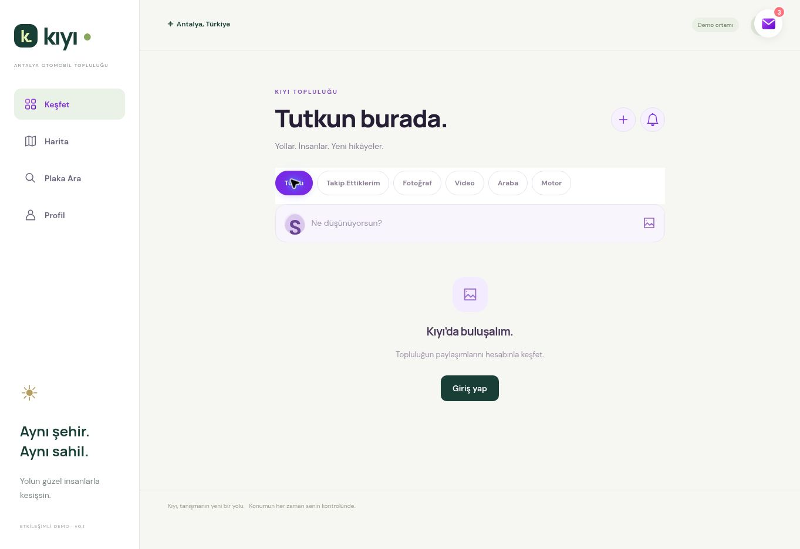

# Kıyı — Aşama 4

24 Ekim 2026. Keşfet ve sosyal paylaşım doğrudan mevcut projeye uygulandı. Aşama 5 başlatılmadı.

## Tamamlanan özellikler

- Keşfet rotası, alt menü bağlantısı; mevcut Harita, Plaka Ara ve Profil korunur.
- Tümü, Takip Ettiklerim, Fotoğraf, Video, Araba, Motor: gerçek Supabase verisinde filtreleme; yeniden eskiye sıralama; kararlı cursor ile 20 kayıtlık sayfalama, sunucuda en fazla 30. Geç gelen filtre yanıtı yeni seçimi ezemez.
- Profil fotoğrafı/çerçevesi, kullanıcı adı, mevcut doğrulanmış hesap işareti, zaman, görünürlük, metin, medya, araç, beğeni ve yorum sayıları, gönderi menüsü. Eski müzik/anket gönderileri korunur.
- Referanstaki form düzeni Kıyı'nın mor/açık tasarımına uyarlandı: metin, fotoğraf/video önizlemesi ve kaldırma, garajından araç, genel bölge etiketi, herkese açık/takipçi seçimi. Boş gönderi engeli, yükleme durumu, hatada taslağı koruma, tekrar isteğinde tek kayıt, gönderim sırasında kontrolleri kilitleme.
- Kendi gönderisini düzenleme/silme; eski sürümle değişikliği engelleyen HTTP 409. Diğer gönderilerde mevcut şikâyet ve engelleme sistemi kullanılır.
- Profilde Gönderiler ve Garajım sekmeleri. Keşfet ve profil aynı gönderi kayıtlarını kullanır. Eski cihaz paylaşımları ayrıca korunur.
- Kendi otomobil/motosikletini etiketleme ve yetkisi tekrar kontrol edilen araç detayı. Gizli/silinmiş araç ve plaka açığa çıkmaz; ham araç/işlem kimlikleri dış JSON'dan çıkarılır.
- Hayalet/Premium görünürlüğü akış ve medya erişiminde denetlenir; kapalı kimlikler gönderi/yorum üzerinden açılmaz. Yeni rozet veya gelişmiş bildirim sistemi kurulmadı.

## Veritabanı

Canlı Supabase'e iki migration başarıyla uygulandı:

1. `20261024145404_stage4_social_feed.sql`
2. `20261024151628_stage4_http_conflict.sql`

| Nesne | Değişiklik |
| --- | --- |
| `public.kiyi_posts` | `vehicle_id`, `location_label`, `version`, `updated_at`, `request_id`; FK, konum kısıtı, idempotensi ve akış indeksleri |
| `kiyi_private.stage4_backup` | Önceki fonksiyon tanımları; RLS açık, istemci erişimi kapalı |
| `command`, `post_json`, `can_post` | Listeleme, düzenleme, detay, şikâyet, etiket/kimlik/görünürlük kontrolü |
| `social_vehicle`, `social_identity_visible` | İzin verilen araç ve kimlik verisini döndüren özel yardımcılar |
| `kiyi_replaced_post_media` | Değiştirilen/kaldırılan eski medyayı mevcut temizleme kuyruğuna alır |
| Mevcut `command_stage2`, `command_stage3` | İş kuralı sürüm çakışması `40001` yerine `PT409`; kredi/envanter mantığı aynı |

Sosyal tablolar yeniden kurulmadı. RLS açılmadı; doğrudan INSERT/UPDATE/DELETE/TRUNCATE grant'ları verilmedi. Mevcut kimlik doğrulamalı komut sınırı kullanılır. Yeni Storage kovası/Edge Function oluşturulmadı.

Araç, profil, cüzdan, görünüm ve araç özelleştirme satırlarının migration öncesi/sonrası özetleri birebir eşleşti. 21 otomobil + 18 motosiklet, toplam 39 model korundu. Önceki finansal ve garaj SQL regresyonları da geçti. Geçici HTTP test hesapları, gönderileri ve medya kayıtları temizlendi; test hesabı 0, test medya kaydı 0, başlangıçtaki gibi gönderi sayısı 0.

## Medya / ücretsiz plan

Mevcut private `kiyi-media` kovası ve worker kullanılır. JPEG/PNG/WebP en fazla 5 MiB, MP4/WebM en fazla 20 MiB. İstemci MIME/boyut; sunucu MIME/boyut/imza/sahiplik denetler. Var olan bütçeler: kişi başına 50 MiB, proje 500 MiB, saatte 30 rezervasyon. İmzalı bağlantı 60 saniye. Lazy görseller, metadata ön yükleyen ve kendiliğinden başlamayan video; gereksiz yorum avatarı imzaları gönderilmez.

Silinen gönderi listeden hemen çıkar; fiziksel dosya mevcut saatlik worker ile Storage API üzerinden temizlenir. Başka gönderi/profil referans veriyorsa dosya korunur. Tamamlanmamış yüklemeler mevcut zaman aşımıyla temizlenir. Daha önce verilmiş imzalı bağlantı süresi dolana kadar geçerli olabilir.

Resmi Free sınırları kontrol edildi: 1 GB dosya depolaması, ayrı 5 GB egress ve 5 GB cached egress. 500 MiB uygulama bütçesi bant genişliği garantisi değildir; organizasyondaki diğer projeler de kotayı tüketebilir. Aylık egress için yeni kesin sayaç veya sınırsız kullanım iddiası yoktur. [Resmi fiyatlandırma](https://supabase.com/pricing), [Storage hesabı](https://supabase.com/docs/guides/platform/manage-your-usage/storage-size).

## Test sonuçları

| Test | Sonuç |
| --- | --- |
| Eski Node testleri | 123/123 geçti |
| Yeni Keşfet testleri | 10/10 geçti |
| Kaynak geri yüklendikten sonraki birleşik son çalışma | 133 geçti, 0 başarısız, 0 atlanan; 21,8 saniye |
| `stage4-social.sql`, gerçek Supabase | İki auth kimliği, authenticated rolü; tüm assertion'lar geçti, ROLLBACK |
| `domain-integration.sql` | Finansal/sosyal regresyon geçti |
| `stage3-garage.sql` | Karma garaj, özelleştirme/kredi, plaka arama, harita ve yetki regresyonu geçti |
| `stage2-catalog.sql` | Katalog kontrolü geçti |
| Normal geri alma dosyası | Canlı DB'de transaction içinde doğrulandı, ROLLBACK; sistem geri alınmadı |
| Gerçek Auth/REST/Storage | İki geçici hesabın gerçek JWT oturumuyla aşağıdaki senaryolar geçti |

SQL kapsamı: metin/fotoğraf/video, boş gönderi reddi, idempotensi, sahiplik, altı filtre, sayfalama, sürüm çakışması, profil görünürlüğü, beğeni/yorum, rapor, engel, Hayalet, özel plaka ve araç detayının gizlenmesi, medya kuyruğu, hâlâ referans verilen dosyanın korunması.

HTTP kapsamı: iki hesaba gerçek giriş; PNG ve geçerli MP4 yükleme; imza/tür reddi; paylaşılmamış medya erişiminin reddi; gerçek gönderi/araç filtreleri; imzalı videonun indirilmesi; yabancı düzenleme/silme/medya/araç reddi; düzenleme ve eski sürüm reddi; takipçi gönderisi ve medya erişimi; profil gönderileri; beğeni/yorum; özel araç etiketi; engel; gönderi silme. Worker kontrolünde Storage dosyaları ve registry sıfırlandı; test hesapları sonradan silindi.

Eski 123 testin bir bölümü önceki yerel API'yi kapsar; Supabase fotoğraf desteği ayrıca gerçek SQL/HTTP kontrolleriyle doğrulandı.

## Başarısızlıklar ve düzeltmeler

- Bir yeni test fixture'ında zorunlu `visibility` alanı eksikti: başarısız oldu, fixture düzeltildi ve geçti. Şema gevşetilmedi.
- HTTP testi eski sürümle düzenlemede zaman aşımına girdi; uzun zaman aşımı da çözmedi. Bu projenin PostgREST 14 sürümü `40001` iş kuralı hatasını yeniden deniyordu. Ayrı migration gönderi ve eski araç sürüm çakışmalarını HTTP 409'a çevirdi; kalan HTTP senaryoları yeniden çalıştırılarak geçti. [Supabase açıklaması](https://supabase.com/kb/troubleshooting/high-cpu-and-infinite-transaction-retries-when-using-custom-error-codes-in-rpc-functions).
- Çalışma ortamı yenilendi: kayıtlı kaynak ve canlı migration tanımları geri alındı, istemci kaynakları tamamlandı, 133 test ve gerçek DB regresyonları tekrar geçirildi.
- Güvenlik danışmanındaki mevcut `RLS Enabled No Policy` INFO kayıtları komut sınırı ve kapalı grant'larla uyumludur; gelişigüzel policy açılmadı. Mevcut Auth sızdırılmış şifre koruması WARN'ı devam eder; Auth planı/ayarları değiştirilmedi. [Açıklama](https://supabase.com/docs/guides/auth/password-security#password-strength-and-leaked-password-protection).

## Geri alma

`supabase/rollback/stage4_social_feed.sql` ve Sites arayüz sürümü 116 kullanılabilir. Kullanıcı kayıtları, ek alanlar, kuyruk ve gizlilik korumaları silinmez. Güvenli HTTP çakışma kodu korunur. İleri dönüşte yalnız komut fonksiyonu geri yüklenir; migration'ın ALTER/RENAME/CREATE adımları tekrar çalıştırılmaz. Ayrı `stage4_http_conflict.sql` tanısal geri alma dosyası eski retry riskini döndürdüğü için normal geri alma adımı değildir.

## Değişen dosyalar

- `public/explore-system.js`, `public/explore-system.css`
- `public/app.js`, `public/map-v2.js`, `public/garage-system.js`
- `public/status-system.js`, `public/supabase-account.js`, `public/kiyi.html`
- Yukarıdaki iki migration ve `supabase/rollback/stage4_*.sql`
- `tests/explore-system.test.mjs`, `tests/stage4-social.sql`, `tests/stage4-http-smoke.py`
- `docs/admin/stage4-report.md`

Yeni stok/marka görseli eklenmedi. Garaj, motosiklet görselleri, plaka tasarımları, harita bölgeleri ve kredi ekonomisi korundu.

## Kalan sınırlar

Gerçek iPhone/Android cihazında oturum açılmış tam görsel test yapılmadı. Çoklu medya, video dönüştürme, öneri algoritması, yeni rozet ve gelişmiş bildirim bu aşamanın kapsamı değildir. Aylık bant genişliği ve depolama kullanımı gerçek trafikle izlenmelidir.

## Yayın ve son tarayıcı kontrolü

Üretim derlemesi ve Sites yayını başarılı. Keşfet sayfası bulut Chrome'da açıldı; dört menü bağlantısı, altı filtre, Tümü/Motor seçiminin değişmesi ve oturum açılmadan sahte gönderi üretilmemesi görüldü. Keşfet kaynaklı JavaScript hatası görülmedi. İlk Harita açılışında ortamın WebGL desteği yoktu; harita zemininin görsel kontrolü bu nedenle sınırlı. Tarayıcı eklentisine ait hata uygulama hatası olarak sayılmadı.

[Keşfet](https://kiyi-antalya-tur.modesttuna8.chatgpt.site/#explore)

Bu ekran görüntüsü oturum açılmış paylaşım akışının görsel testi değildir. Gerçek hesapların yazma/erişim kontrolleri yukarıdaki HTTP testinde yapıldı; gerçek mobil cihaz ve oturum açılmış tam arayüz testi yapılmadı. Son değişen dosyalara `docs/admin/stage4-explore.jpg` de dahildir.
