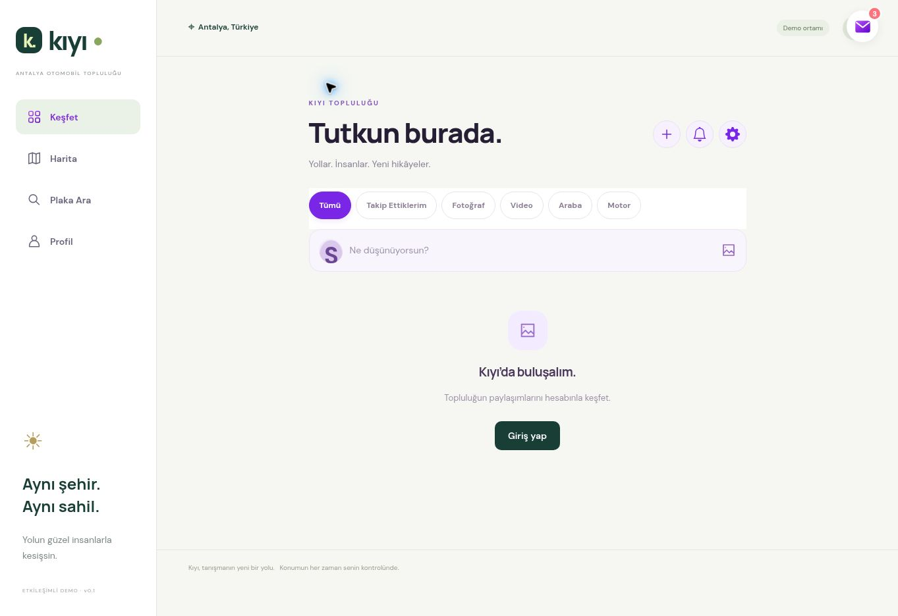

# Kıyı — Aşama 5 raporu

24 Ekim 2026. Sosyal etkileşimler mevcut Keşfet, kimlik ve tablolar üzerine uygulandı. Aşama 6 başlatılmadı.

## Uygulananlar

- Beğenme/geri çekme mevcut `kiyi_likes` kayıtlarını kullanır. `(post, person)` anahtarı aynı kullanıcı için çift kaydı engeller. Durum ve sayı sunucudan okunur; yenilemede korunur. Hızlı çift dokunmada aynı istemci isteği birleştirilir.
- Yorum oluşturma, kendi yorumunu düzenleme/silme ve gönderi sahibinin yorumu kaldırması. Gönderi sahibi başkasının yorumunu yeniden yazamaz. Sürüm çakışması HTTP 409, tekrar istekleri için işlem kimliği ve doğru yorum sayısı.
- Yorumlar kart üstünde açılan mobil panelde; 30 kayıtlık sayfalama, en fazla 50. Metin kaçışlanır, kullanıcı adı profili açar. Boş/beyaz boşluk yorumu ve 60 saniye içindeki normalize edilmiş aynı yorum reddedilir.
- Beğeni 60, takip 30, yorum oluşturma/düzenleme 20, yönetim 60, plaka araması 30, izin değişimi 10 işlem/dakika. Sınırlar sunucuda hesap ve işlem türüne göre atomik, sabit dakika pencerelerinde tutulur. Dakika değişiminde pencere yenilenir. Bu, ağ seviyesinde DDoS koruması iddiası değildir.
- Gönderi kartında takip et/takipten çık; gerçek takip ilişkileriyle Takip Ettiklerim filtresi; engellenen hesapların içeriğine erişimin reddi.
- Native paylaşım / bağlantı kopyalama / elle kopyalama seçeneği. `#post/<uuid>` doğrudan gönderiyi açar. URL'deki mevcut sorgu parametreleri taşınmaz. Bağlantı; giriş, takipçi, engel, Hayalet ve Premium kontrollerini aşmaz.
- Önceki tek araç etiketi korunur. Kendi garajından seçim yanında, mevcut plaka aramasıyla izin veren başka hesabın görünür aracı seçilebilir. Yeni çoklu etiket tablosu oluşturulmadı.
- Etiketlenme izni varsayılan kapalıdır. Keşfet ve kendi profilinden açılan izin paneli, görünür son 30 etiket ve tek tek kaldırma içerir. İzni kapatmak görünmeyen/eski etiketler dahil başkalarının gönderilerindeki etiketleri kaldırır. Yeniden açınca eski etiket geri gelmez.
- Araç gizlenince/silinince/plakası veya sahibi değişince ve hesaplar engelleşince yabancı araç etiketleri kaldırılır. Kendi araç etiketi bu işlemden etkilenmez. Araç/plaka detayına erişim her okumada sunucuda yeniden denetlenir.

## Supabase işlemleri

Yedi migration uygulandı:

1. `20261024183225_stage5_social_interactions.sql`
2. `20261024185323_stage5_tag_revocation.sql`
3. `20261024185324_stage5_comment_commands.sql`
4. `20261024185339_stage5_social_commands.sql`
5. `20261024204123_stage5_unlike_alias.sql`
6. `20261024204912_stage5_private_garage_array.sql`
7. `20261024205540_stage5_comment_spam_index.sql`

| Nesne | Değişiklik |
| --- | --- |
| `kiyi_comments` | `version`, `updated_at`, `request_id`; idempotensi ve sayfalama indeksleri |
| `kiyi_privacy` | `allow_plate_tags`, varsayılan false |
| `kiyi_private.social_limits` | Hesap/işlem için sınırlı sayıda hız sayacı; kullanıcı silinmesinde cascade |
| `kiyi_private.stage5_backup` | Önceki fonksiyon tanımları |
| `command`, `comment_ops`, `comment_json`, `post_json` | Yorum yetkileri, takip durumu, sayfalama, etiket izni ve güvenli JSON |
| `social_person`, `social_rate` | Görünür kimlik bilgileri ve sunucu hız sınırı |
| `revoke_plate_tags` / üç trigger | İzin, araç ve engelleme değişiminde etiketlerin kaldırılması |
| Önceki komut fonksiyonları | Beğeni geri çekmede alan adı çakışması; gizli garajın boş liste türü düzeltildi |

`kiyi_posts`, `kiyi_likes`, `kiyi_follows` yeniden oluşturulmadı. Yeni para birimi, rozet, bildirim altyapısı, Storage kovası veya Edge Function eklenmedi. RLS açık kaldı; sosyal tablo yazmaları için geniş policy/grant eklenmedi. Özel yardımcıların istemciden çağrılması engellendi. Kimlik kullanıcı metadata'sından veya payload'daki kişi alanlarından alınmaz; `auth.uid()` kullanılır.

## Test sonuçları

| Kontrol | Sonuç |
| --- | --- |
| Değişiklik öncesi mevcut testler | 133/133 geçti |
| Yeni istemci testleri | 8/8 geçti |
| Birleşik çalışma | 141 geçti, 0 başarısız, 0 atlanan; yaklaşık 21 saniye |
| `stage5-social.sql` | İki auth kimliği ve authenticated rolüyle gerçek Supabase'de geçti; tüm fixture'lar ROLLBACK |
| `stage5-privacy-pagination.sql` | Hayalet/Premium yorum/etiket ayrımı, 35 yorumun sayfalanması ve engelleme geçti; ROLLBACK |

Yeni SQL kapsamı: beğenme/geri çekme/yeniden okuma, idempotensi, boş/tekrar yorum, düzenleme ve eski sürüm reddi, kendi yorumunu silme, gönderi sahibinin moderasyonu, yabancı yorumun düzenlenememesi/silinememesi, takip filtresi, plaka izni, normalize arama, izin reddi, etiketin sahibi tarafından kaldırılması, izin kapatıp açınca geri gelmeme, gizli plaka, engel, bağlantı erişimi ve doğrudan tablo yazma reddi. Beğeni/yorum/takip eşiklerinde HTTP 429 ayrıca kontrol edilir.

Gerçek HTTP testi için iki geçici Auth hesabı oluşturuldu; giriş yapılarak gerçek JWT oturumları kullanıldı. Testler sahte kimlik başlığına dayanmaz. API kapsamı: beğeni/geri çekme/yenileme, payload kişi kimliği sahteciliğinin etkisizliği, yorum oluşturma/düzenleme/silme/moderasyon, boş/tekrar/eski sürüm reddi, takip/takipten çıkma, özel gönderi bağlantısı, plaka araması/izni/etiketi/kaldırılması, araç gizleme, engelleme, yetkisiz gönderi silme ve çıkış. Bu HTTP senaryolarının tamamı geçti. İki hesaptan çıkış yapıldı, geçici hesaplar ve gönderileri temizlendi; kalan test hesabı sayısı 0.

## Yakalanan hatalar ve başarısız denemeler

- İlk beğeni geri çekme testi eski komuttaki `person` değişkeni ile tablo alanının çakışması nedeniyle başarısız oldu. Tablo alanları alias ile belirtildi; aynı test tekrar geçti.
- İlk toplu hız testi dakika penceresine bağlı tutarsız sonuç verdi. Sayacın arttığı ve 60'da kaldığı tanı sorgusuyla görüldü. Test; pencere sınırını mevcut fixture sayacında hazırlayıp gerçek API işleminin 429 dönmesini denetleyecek şekilde sabitlendi. Ürün limitleri gevşetilmedi.
- Hayalet plaka araması, eski gizli garaj yanıtının JSON dizi yerine `"[]"` metni dönmesi nedeniyle hata verdi. Mevcut fonksiyondaki boş değer JSON diziye düzeltildi; görünürlük kuralı açılmadı.
- Premium fixture'ı ilk denemede olmayan entitlement satırını UPDATE ettiği için yetki vermedi ve test başarısız oldu. Yalnız transaction içindeki test hesabına INSERT/ON CONFLICT ile geçici yetki verildi; test geçti. Gerçek üyeliklere dokunulmadı.
- Bazı ilk migration çağrıları `Invalid or expired requestState` araç hatası döndürdü. Şema, fonksiyon ve migration geçmişi kontrol edildi; değişiklikler ayrı migration'larla uygulandı ve son durum doğrulandı.
- CLI telemetri isteği otomatik güvenlik denetiminde reddedildi. Sonraki CLI komutları resmi telemetri kapatma değişkenleriyle çalıştırıldı. İlgisiz analitik isteği için izin genişletilmedi.

## Geri alma

Normal geri alma arayüzü sürüm 118'e döndürür; eklenen veritabanı alanları eski istemciyle uyumludur ve korunabilir. İsteğe bağlı `supabase/rollback/stage5_social.sql` önceki komut yönlendiricisini getirir. Kullanıcı kayıtları, yorumlar, izinler, koruyucu trigger'lar ve beğeni düzeltmesi silinmez. Bu DB geri alması yapılırsa mevcut yabancı etiketli gönderinin düzenlenmesi Stage 5'in yeniden etkinleştirilmesini gerektirir. İleri dönüşte sadece Stage 5 komut tanımı geri yüklenir; ilk migration'lar bütünüyle tekrar çalıştırılmaz.

## Değişen dosyalar

- `public/social-interactions.js`, `public/social-interactions.css`
- `public/app.js`, `public/explore-system.js`, `public/supabase-account.js`, `public/kiyi.html`
- Yukarıdaki yedi migration ve `supabase/rollback/stage5_social.sql`
- `tests/social-interactions.test.mjs`, `tests/stage5-social.sql`, `tests/stage5-privacy-pagination.sql`, `tests/stage5-http-smoke.py`
- `docs/admin/stage5-report.md`

## Kalan sınırlar

Gerçek iPhone/Android cihazında oturum açılmış tam görsel test yapılmadı. Native paylaşım sistem penceresi ve işletim sistemi panosu iki fiziksel cihazda doğrulanmadı. Raporlanan gerçek hesap testleri API/DB akışlarıdır. Etiket yönetimi paneli son 30 görünür gönderiyi listeler; izni kapatmak bütün yabancı etiketleri kaldırır. Mevcut onay işareti kullanılır; Aşama 6 rozetleri ve gelişmiş bildirimler eklenmedi.

## Son doğrulamalar

Eski `domain-integration.sql`, `stage3-garage.sql`, `stage4-social.sql` ve `stage2-catalog.sql` gerçek Supabase bağlantısında yeniden geçti. Böylece kredi/hediye/envanter, araç özelleştirme, karma garaj, plaka arama, harita türü/Hayalet ve önceki medya/gönderi akışları kontrol edildi. Geri alma dosyası transaction içinde doğrulandı ve ROLLBACK yapıldı; çalışan sistem geri alınmadı.

Araç, profil, cüzdan ve araç özelleştirme satırlarının başlangıç/son özetleri birebir eşleşti. Katalog 39 model olarak korundu. Test hesapları ve test gönderileri 0; başlangıçtaki kullanıcı verileri korunuyor. Üretim derlemesi geçti.

Güvenlik danışmanının mevcut RLS/policy INFO kayıtları, komut sınırı ve kapalı grant'larla uyumlu bırakıldı. Önceden var olan sızdırılmış şifre koruması WARN'ı devam ediyor; bu aşamada Auth planı veya parola ayarları değiştirilmedi. [Supabase açıklaması](https://supabase.com/docs/guides/auth/password-security#password-strength-and-leaked-password-protection).

Son sorgu kontrolünde spam kontrolünün `author, created` filtresi için indeks de hazırlandı; sunucu limitleri değişmedi.

## Yayın ve tarayıcı kontrolü

Sites üretim yayını başarılı. Bulut Chrome'da Keşfet, yeni plaka etiketleme izinleri düğmesi, gönderi bağlantısı rotası, oturum açılmadan içerik gösterilmemesi ve Keşfet'e dönüş doğrulandı. Yeni uygulama JavaScript hatası görülmedi; tarayıcı eklentisi kaynaklı hata uygulama hatası sayılmadı.

[Keşfet](https://kiyi-antalya-tur.modesttuna8.chatgpt.site/#explore)

Bu görsel, oturum açılmış yorum/etiket panellerinin uçtan uca görsel testi değildir. Yetki ve yazma senaryoları gerçek hesaplarla API/DB'de test edildi. Değişen dosyalara `docs/admin/stage5-explore.jpg` dahildir.
