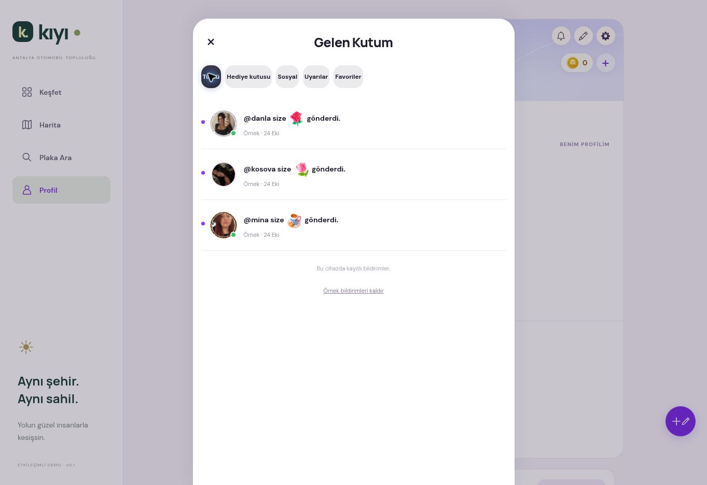

# Aşama 6 — Rozetler, sosyal bildirimler ve moderasyon

25 Ekim 2026, Türkiye saati. Aşama 7'ye geçilmedi.

## Uygulanan özellikler

- Profilde mevcut Gönderiler / Garajım sekmelerine **Rozetler** eklendi. İlk Araç, İlk Gönderi, 10 Gönderi, 100 Takipçi ve Onaylı Hesap gerçek verilerden hesaplanır. `(owner, code)` anahtarı tekrar ödüllendirmeyi engeller. Dört başarı rozeti kazanıldıktan sonra korunur; Onaylı Hesap yalnızca mevcut `kiyi_entitlements.verified` etkinse gösterilir. Mevcut mor doğrulama işareti değiştirilmedi.
- Mevcut kullanıcının mevcut başarıları bildirim yağmuru oluşturmadan geriye dönük hesaplandı. Sonraki kazanımlar sunucu tetikleyicileriyle bildirilir. Bundle uzlaştırması eşiklerin sonradan da tamamlanmasını sağlar.
- Mevcut Gelen Kutusu'na **Sosyal** kategorisi eklendi. Takip, beğeni, yorum, izinli plaka etiketi ve rozet bildirimleri mevcut `kiyi_notifications` içinde tutulur. Hediye kutusu ve uyarılar ayrı kaldı.
- Bildirimler aktörün izin verilen profil fotoğrafını ve işlem açıklamasını gösterir. Gönderi/profil hedefi açılırken sunucu yeniden yetkilendirir; eski istemci hedefi kullanılmaz. Okundu durumu kalıcıdır. Kendine beğeni bildirimi yoktur. Tekrar takip/beğeni/etiket aynı olay anahtarından ikinci bildirim oluşturmaz.
- Sosyal bildirimlerin beş türü ayrı açılıp kapatılır. Tercihler yalnızca sonraki uygulama içi olayları etkiler; hediye, kredi ve güvenlik akışlarına dokunmaz. Telefon push altyapısı bağlı değildir ve arayüz bunu açıkça belirtir.
- Gönderi ve yorum için altı şikâyet nedeni eklendi. Aktif aynı içerik şikâyeti yinelenmez; dakika ve saat sınırları sunucudadır. Kullanıcı yalnızca kendi şikâyetlerinin durumunu görür.
- Mevcut Kıyı Yönetim paneli genişletildi: durum filtresi, şikâyetten içeriğe ve ilgili moderasyon geçmişine erişim, içerik gizleme ve hesap kısıtlama. Mevcut gerekçe, istek kimliği, rol, gerçek MFA ve yönetici oturum süresi denetimleri korundu. İçerik gizleme fiziksel silme değildir ve geri alınabilir.
- Mevcut engelleme sunucuda takipleri sonlandırır, içerikleri ve bildirim kimliklerini gizler, özel hedeflere erişimi reddeder. Engeli kaldırma ekranı eklendi; eski takipler otomatik geri kurulmaz.
- Destek / topluluk açıklaması mevcut destek talebi sistemine bağlandı.

## Değişen dosyalar

Ana uygulama deposu:

| Dosya | Değişiklik |
|---|---|
| `public/social-safety.js` | Rozetler, bildirim tercihleri ve güvenli yönlendirme, içerik şikâyeti, şikâyet durumu, engel kaldırma, destek |
| `public/social-safety.css` | Kompakt rozetler, tercihler, rapor/engel satırları ve yatay sekmeler |
| `public/inbox.js` | Sosyal kategori, bildirim metni/hedefi, bundle yenilemesi, ayar erişimi, doğru boş durum |
| `public/supabase-account.js` | Yetkilendirilmiş bildirim aktörlerinin fotoğrafları, tercihler ve hedef alanlarının eşlenmesi |
| `public/garage-system.js` | Üçüncü profil sekmesi ve sekmeler arası doğru görünürlük |
| `public/social-interactions.js` | Mevcut yorumların yanında şikâyet eylemi |
| `public/kiyi.html` | Yeni stil/script ve değişen dosyaların cache sürümleri |
| `supabase/migrations/*stage6*.sql` | Aşağıdaki beş migration |
| `supabase/rollback/stage6-disable.sql` | Verileri silmeden Aşama 5 dispatcher'ına dönüş |
| `tests/social-safety.test.mjs` | On yeni işlevsel arayüz testi |
| `tests/stage6-social.sql` | Bildirim, tercih, rozet, rapor, RLS/grant testleri |
| `tests/stage6-milestones.sql` | 10 gönderi, 100 takipçi, doğrulama iptali ve hız sınırı |
| `tests/stage6-notification-privacy.sql` | Hayalet / Premium bildirim ve profil ayrımı |
| `tests/stage6-http-smoke.py` | İki gerçek Auth oturumuyla sosyal senaryolar |
| `tests/stage6-admin-http.py` | Gerçek TOTP ile yönetici senaryoları |
| `tests/domain-integration.sql` | Engelleme kontrolünün hedef aktöre özgülenmesi; kullanıcının kendi başarı bildirimi engellenmiş içerik sayılmaz |
| `docs/admin/stage6-report.md` | Bu rapor |

Ayrı **Kıyı Yönetim** deposu: `src/operations.js`, bu kaynaktan üretilen `worker/index.js` ve `docs/stage6-moderation.md`. Yönetici giriş/şifre/MFA ve çerez koruması değiştirilmedi.

## Veritabanı ve migration sonuçları

Yeni tablolar: `public.kiyi_badges`, `public.kiyi_social_preferences`, yalnızca geri dönüş için `kiyi_private.stage6_admin_backup`.

Genişletilen tablolar: `kiyi_notifications` (hedefler ve olay anahtarı), `kiyi_reports` (içerik türü/kimliği). Mevcut `kiyi_follows`, `kiyi_likes`, `kiyi_comments`, `kiyi_posts`, `kiyi_vehicles`, `kiyi_entitlements` tablolarına olay tetikleyicileri eklendi. Mevcut yönetici audit, istek ve yaptırım tabloları tekrar kullanıldı.

| Canlı veritabanı sürümü / dosya | Sonuç |
|---|---|
| `20261024210919_stage6_badges_notifications.sql` | Uygulandı |
| `20261024210925_stage6_social_commands.sql` | Uygulandı |
| `20261024211225_stage6_moderation_detail.sql` | Uygulandı; ilk denemenin SQL sonlandırma hatası transaction içinde geri alındı |
| `20261024211852_stage6_preference_read_fix.sql` | Uygulandı; gerçek hesap testinde bulunan tercih okuma hatasını düzeltir |
| `20261024212400_stage6_social_indexes.sql` | Uygulandı; bildirim temizliği ve moderasyon geçmişi indeksleri |

Dosyaların sürümleri Supabase'in döndürdüğü uygulanmış sürümlerle eşlendi. RLS politikaları açılmadı. Yeni tabloların doğrudan `anon` / `authenticated` izinleri kaldırıldı; yetkilendirilmiş mevcut RPC sınırı kullanılır. Yeni özel yardımcı fonksiyonlar istemciye açılmadı.

Geri dönüş dosyası tetikleyicileri devreden çıkarır, önceki dispatcher'ı ve yedek yönetici fonksiyonunu geri getirir. Rozet, tercih, şikâyet ve bildirim kayıtlarını **silmez**. Önceki frontend sürümüyle birlikte uygulanmalıdır. Canlıya geri dönüş yapılmadı; üretim verisi üzerinde yıkıcı geri alma provası yapılmadı.

## Test sonuçları

| Test grubu | Sonuç |
|---|---|
| Başlangıçtaki 141 Node testi | 141 geçti, 0 başarısız |
| Son ana uygulama testi | **151 geçti, 0 başarısız, 0 atlandı** |
| Yönetici paneli | **34 geçti, 0 başarısız** |
| Üç yeni SQL senaryosu | Geçti, fixture'lar ROLLBACK ile kaldırıldı |
| Aşama 3 garaj SQL regresyonu | Geçti |
| Aşama 4 gönderi/medya/filtre/temizleme SQL regresyonu | Geçti |
| Aşama 5 sosyal SQL + hayalet/Premium/sayfalama | İkisi de geçti |
| Hediye/kredi/envanter/gizlilik/engelleme domain SQL | Geçti |
| İki gerçek Auth hesabıyla HTTP | Takip/beğeni/yorum/etiket/rozet, tekrar engeli, kalıcı tercihler, okundu durumu, şikâyet ayrımı, doğrudan tablo ve yabancı bildirim erişimi reddi, engelleme/engel kaldırma geçti |
| Gerçek MFA yönetici HTTP | AAL1 reddi, TOTP AAL2, yönetici lease'i, şikâyet detay/durum, yorum/gönderi gizleme, doğru yorum sayısı, gizlenen içeriğin bildiriminin saklanması, audit geçmişi, normal kullanıcının yönetici işlemine reddi ve hesap askısı geçti |
| Ana uygulama build | Başarılı |
| Yönetici build + ESM artifact doğrulaması | Başarılı |
| Canlı tarayıcı | Profil ve Gelen Kutusu / Sosyal sekmesi kontrol edildi; boş durum ve katman düzeltmeleri yapıldı |

**Başarısız denemeler gizlenmedi:** Yönetici testinin ilk koşusunda eksik PGlite bağımlılığı dört dosyanın çalışmasını engelledi; kilitli bağımlılık kurulduktan sonra 34/34 geçti. İlk geçici Auth kurulumu eksik fixture alanlarından dolayı 400/500 verdi; yalnızca fixture kayıtları düzeltildi. Yeni milestone SQL fixture'ında zorunlu `visibility` alanı eksikti; düzeltildi. Yönetici migration'ının ilk SQL sonlandırma hatası geri alındı ve düzeltildi. Gerçek HTTP testi tercih kaydının yeniden okunmasında gerçek bir hata buldu; ayrı migration ve regresyon kontrolüyle düzeltildi. İki eski SQL akış testi canlı geçici gönderi varken global akışın boş olmasını beklediği için ilk koşuda başarısız oldu; geçici gönderiler temizlenince Aşama 4 değişmeden geçti. Domain testindeki engelleme beklentisi yeni kendi-rozet bildirimini de yanlışlıkla dışlıyordu; engellenen aktöre ilişkin kontrol açıkça korunarak düzeltildi. Son koşularda başarısız test yoktur.

## Veri koruma doğrulaması

İki geçici hesabın gönderileri kendi API'sinden silindi, oturumları kapatıldı, yalnızca bu fixture'lara ait MFA/rol/lease/audit/yaptırım ve Auth kayıtları temizlendi. Fixture hesabı sayısı: **0**. Test gönderisi kalmadı. Parolalar ve token'lar depoya eklenmedi; geçici kimlik bilgisi dosyaları kaldırıldı.

Aşama 5 sonunda kaydedilen satır içerik hash'leriyle karşılaştırma aynı sonucu verdi:

| Veri | MD5 (satır içeriği karşılaştırması; güvenlik amaçlı hash değildir) |
|---|---|
| Profiller | `4df32a38554cf6e5302c9d3992c1cc5c` |
| Araçlar / plakalar | `c8c083b4ac04fb3f13e6a18d23408d5a` |
| Kredi cüzdanları | `32571ae0025ff9428e6b349473e2faab` |
| Araç özelleştirmeleri | `291385ca36a9aa819f7b3fdd8f6f89f3` |
| Eski görünüm kayıtları | `5e316a9fb320f0161f58284366e2283b` |

21 otomobil + 18 motosiklet = **39 model** korundu. Bu aşamada araç görseli veya medya kovası eklenmedi.

## Kalan sınırlar

- Gerçek telefon push servisi yoktur; uygulama içi bildirimler çalışır. Ön planda mevcut bundle yenilemesi kullanılır; arka planda telefon bildirimi gönderildiği iddia edilmez.
- Fiziksel iPhone/Android ve oturum açılmış mobil görsel E2E yapılmadı. İki gerçek hesabın işlev ve yetkilendirme testleri HTTP üzerinden yapıldı; tarayıcıdaki görsel kontrol oturumsuz ekranla sınırlıdır. Cihaz/mağaza testi ayrıca gereklidir.
- Moderasyon insan incelemesi, sunucu yetkileri, şikâyet ve engelleme üzerine kuruludur; otomatik görsel/video uygunsuzluk sınıflandırıcısı yoktur. Operasyon ekibinin yanıt süresi ve herkese açık gerçek iletişim bilgisi işletme tarafından sağlanmalıdır. Apple 1.2; filtreleme, şikâyete zamanında yanıt, engelleme ve yayımlanmış iletişim bilgisi ister. Bu çalışma App Store kabulü anlamına gelmez. Kaynak: https://developer.apple.com/app-store/review/guidelines/#user-generated-content
- Supabase'in mevcut sızmış parola koruması uyarısı sürüyor; hesap ayarı değiştirilmedi. İlgili kılavuz: https://supabase.com/docs/guides/auth/password-security#password-strength-and-leaked-password-protection
- Yeni korumalı tablolar için “RLS açık, politika yok” bilgi notu beklenir: doğrudan erişim kaldırılmıştır ve yetkili RPC kullanılır. Açık okuma politikası eklenmedi. https://supabase.com/docs/guides/database/database-linter?lint=0008_rls_enabled_no_policy
- Üretim ölçeğinde yük testi yapılmadı. Aynı projedeki kapsam dışı şema ve önceden var olan performans notlarına müdahale edilmedi.

Uygulama: https://kiyi-antalya-tur.modesttuna8.chatgpt.site/#profile

Yönetim: https://kiyi-yonetim-merkezi.modesttuna8.chatgpt.site

## Görsel kontrol kaydı

Bu görüntü gerçek hesap bildirimlerinin kanıtı olarak sunulmaz; oturumsuz arayüzdeki mevcut örnek hediyeler açıkça “Örnek” olarak işaretlidir. Gerçek bildirim ve MFA işlemleri yukarıdaki iki hesaplı HTTP testleriyle doğrulandı.
